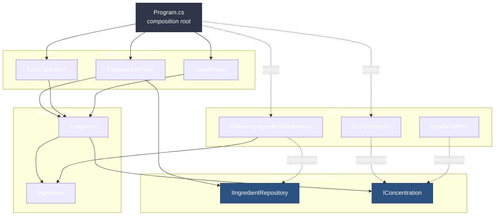
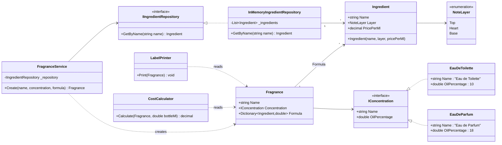
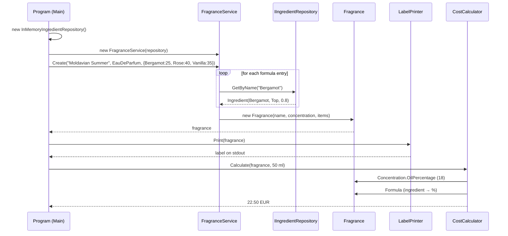

# Laboratory Work Nr. 1 — SOLID Principles

**Course:** TMPS — Software Design Techniques and Mechanisms
**Topic:** Implementation of SOLID principles (minimum 3)
**Project:** `FragranceComposer`
**Technology:** C# / .NET 10 (console application)
**Author:** OBERȘT Eduard FAF_243
**Repository branch:** `lab1`

---

## 1. Objectives

1. Choose a non-trivial problem domain and model it in an object-oriented language.
2. Implement **at least three** of the five SOLID principles in a way that is visible in the structure of the code, not only claimed in the documentation.
3. Keep the solution small enough to be read in one sitting, but structured so that it can grow without rewriting existing classes.
4. Document the resulting architecture and justify each design decision.

---

## 2. The Idea — Domain Description

The application models the work of a **perfumer composing a fragrance**.

A real perfume is not a single liquid — it is a *formula*: a set of aromatic ingredients, each
belonging to a **note layer** (top / heart / base), combined in precise percentages. That oil
concentrate is then diluted in alcohol, and *how much* oil ends up in the bottle is determined
by the **concentration class** of the product:

| Concentration    | Oil content |
|------------------|-------------|
| Eau de Toilette  | ~10 %       |
| Eau de Parfum    | ~18 %       |
| Parfum Extrait   | ~25 %       |

This domain was chosen deliberately because it contains three independent axes of change,
which is exactly what SOLID is meant to handle:

- **the ingredient catalogue** changes (new raw materials, new prices, a different storage medium);
- **the set of concentrations** grows (Extrait, Cologne, Elixir…);
- **what we do with a finished fragrance** grows (print a label, compute a cost, export to PDF, validate a formula).

`FragranceComposer` builds one fragrance — *"Moldavian Summer"* (Eau de Parfum: 25 % Bergamot,
40 % Rose, 35 % Vanilla) — then prints its label and calculates the raw-material cost of a 50 ml bottle.

---

## 3. Project Structure

```
FragranceComposer/
├── Models/
│   ├── Ingredient.cs                  — raw material: name, note layer, price per ml
│   └── Fragrance.cs                   — a composed product: name, concentration, formula
├── Interfaces/
│   ├── IConcentration.cs              — abstraction over the oil-content family
│   └── IIngredientRepository.cs       — abstraction over the ingredient catalogue
├── Concentrations/
│   ├── EauDeToilette.cs               — 10 % oil
│   └── EauDeParfum.cs                 — 18 % oil
├── Repositories/
│   └── InMemoryIngredientRepository.cs— hard-coded catalogue (swappable)
├── Services/
│   ├── FragranceService.cs            — assembles a Fragrance from names + percentages
│   ├── CostCalculator.cs              — computes raw-material cost for a bottle size
│   └── LabelPrinter.cs                — renders the fragrance to the console
└── Program.cs                         — composition root / entry point
```

The folders are not decorative: each one is a **layer with a single responsibility**, and the
dependencies between them only ever point inwards, toward `Models` and `Interfaces`.

---

## 4. Architecture Diagrams

### 4.1 Layered view (dependency direction)



> The only class that knows about concrete implementations is `Program`.
> Everything above the `Interfaces` line is written against abstractions.

### 4.2 Class diagram



### 4.3 Sequence of the main scenario



---

## 5. Implemented SOLID Principles

### 5.1 Single Responsibility Principle (SRP) — primary

> *A class should have one, and only one, reason to change.*

The naive version of this program is a single `Main` that holds the catalogue, builds the
formula, prints the label and computes the price. Instead, every one of those concerns lives in
its own type:

| Class | Single responsibility | Changes when… |
|---|---|---|
| `Ingredient` | hold raw-material data | the domain gains a new attribute (e.g. IFRA limit) |
| `Fragrance` | hold a composed product | the product gains a new attribute (e.g. batch number) |
| `InMemoryIngredientRepository` | supply ingredients | the storage medium or catalogue changes |
| `FragranceService` | translate names + % into a `Fragrance` | the composition rules change |
| `CostCalculator` | compute monetary cost | the pricing formula changes (VAT, alcohol cost) |
| `LabelPrinter` | present a fragrance to the user | the output format changes |
| `Program` | wire the objects together | the configuration changes |

The split is proven by the code itself: `CostCalculator` contains arithmetic and no text,
`LabelPrinter` contains text and no arithmetic.

```csharp
// Services/CostCalculator.cs — money only
public decimal Calculate(Fragrance fragrance, double bottleMl)
{
    double oilMl = bottleMl * fragrance.Concentration.OilPercentage / 100;
    return fragrance.Formula.Sum(f => (decimal)(oilMl * f.Value / 100) * f.Key.PricePerMl);
}
```

```csharp
// Services/LabelPrinter.cs — presentation only
public void Print(Fragrance fragrance)
{
    Console.WriteLine($"=== {fragrance.Name} ({fragrance.Concentration.Name}) ===");
    foreach (var f in fragrance.Formula)
        Console.WriteLine($"{f.Key.Layer} note: {f.Key.Name} {f.Value}%");
}
```

### 5.2 Open/Closed Principle (OCP) — primary

> *Open for extension, closed for modification.*

Concentration is the axis that varies most in this domain, so it is expressed as an abstraction
(`IConcentration`) rather than as an `enum` + `switch`. Adding a new product class requires
**adding** a file, never **editing** one:

```csharp
// Interfaces/IConcentration.cs
public interface IConcentration
{
    string Name { get; }
    double OilPercentage { get; }
}

// Concentrations/EauDeParfum.cs
public class EauDeParfum : IConcentration
{
    public string Name => "Eau de Parfum";
    public double OilPercentage => 18;
}
```

A new `ParfumExtrait : IConcentration { Name => "Parfum Extrait"; OilPercentage => 25; }`
immediately works with `CostCalculator`, `LabelPrinter`, `FragranceService` and `Fragrance` —
**none of those four classes are recompiled logically or touched at all**. Compare with the
alternative that was rejected:

```csharp
// REJECTED — every new concentration forces an edit here, and in every other switch like it
double oil = type switch
{
    ConcentrationType.EauDeToilette => 10,
    ConcentrationType.EauDeParfum   => 18,
    _ => throw new ArgumentOutOfRangeException()
};
```

### 5.3 Dependency Inversion Principle (DIP) — primary

> *High-level modules must not depend on low-level modules; both depend on abstractions.*

`FragranceService` is high-level policy (how a formula becomes a product).
`InMemoryIngredientRepository` is a low-level detail (where ingredient data is kept).
The service never names the concrete class — the dependency is inverted through
`IIngredientRepository` and supplied via **constructor injection**:

```csharp
// Services/FragranceService.cs
public class FragranceService
{
    private readonly IIngredientRepository _repository;   // abstraction, not a concrete type

    public FragranceService(IIngredientRepository repository) => _repository = repository;

    public Fragrance Create(string name, IConcentration concentration,
                            Dictionary<string, double> formula)
    {
        var items = formula.ToDictionary(f => _repository.GetByName(f.Key), f => f.Value);
        return new Fragrance(name, concentration, items);
    }
}
```

```csharp
// Program.cs — the composition root is the only place that knows concrete types
IIngredientRepository repository = new InMemoryIngredientRepository();
var service = new FragranceService(repository);
```

Swapping to `SqlIngredientRepository`, `JsonIngredientRepository` or a test double
`FakeIngredientRepository` is a one-line change in `Program.cs`. `FragranceService` is already
unit-testable without a database, which is the practical payoff of DIP.

### 5.4 Principles satisfied as a consequence

These were not the declared targets of the lab, but the design does not violate them, and that is
worth recording:

- **Liskov Substitution Principle (LSP).** `EauDeParfum` and `EauDeToilette` are freely
  interchangeable wherever `IConcentration` is expected: both honour the same contract
  (a non-empty name, a positive oil percentage), neither strengthens a precondition and neither
  throws where the base contract promises a value. `CostCalculator` works with any of them
  without a type check — no `if (concentration is …)` appears anywhere in the code.
- **Interface Segregation Principle (ISP).** Both interfaces are deliberately minimal —
  `IConcentration` exposes two properties, `IIngredientRepository` exposes one method. No
  implementer is forced to supply a member it does not need. A single fat
  `IFragranceSystem { GetIngredient(); GetOilPercentage(); Print(); Calculate(); }` would have
  been the violation; it was avoided by splitting by *client need*, not by convenience.

---

## 6. Results

Build and run:

```bash
dotnet run --project FragranceComposer
```

Actual program output:

```
=== Moldavian Summer (Eau de Parfum) ===
Top note: Bergamot 25%
Heart note: Rose 40%
Base note: Vanilla 35%
Oil cost for 50 ml: 22.50 EUR
```

Verification of the computed value — the calculation is reproducible by hand:

| Step | Value |
|---|---|
| Bottle | 50 ml |
| Oil fraction (Eau de Parfum) | 18 % → **9 ml of oil** |
| Bergamot 25 % → 2.25 ml × 0.80 €/ml | 1.80 € |
| Rose 40 % → 3.60 ml × 4.00 €/ml | 14.40 € |
| Vanilla 35 % → 3.15 ml × 2.00 €/ml | 6.30 € |
| **Total** | **22.50 €** |

---


## 7. Conclusions

The laboratory work implements a small but genuinely layered C# application, and the three
required SOLID principles are expressed structurally rather than nominally:

- **SRP** turned one would-be `Main` method into seven cohesive types, each with one documented
  reason to change. The clearest evidence is that the cost logic contains no formatting and the
  printing logic contains no arithmetic.
- **OCP** replaced the obvious `enum` + `switch` for concentrations with the `IConcentration`
  abstraction, so the family of products grows by addition. This was the single most valuable
  decision in the project: the `switch` would otherwise have been duplicated in every service
  that needs the oil percentage.
- **DIP** inverted the dependency between `FragranceService` and the ingredient catalogue,
  leaving `Program.cs` as the only place in the system that mentions a concrete implementation.
  As a side effect, the high-level logic became unit-testable without any infrastructure.

**LSP** and **ISP** are additionally respected: substitution requires no type checks anywhere in
the code, and both interfaces are narrow enough that no implementer carries unused members.

The main lesson of the work is that SOLID is not a checklist applied after the fact — it is a set
of decisions about *where change is expected*. The domain was chosen because it has three
independent axes of variation (catalogue, concentration, output), and each principle ended up
protecting exactly one of those axes. Where the domain does not vary — `Ingredient` and
`Fragrance` are plain data holders — no abstraction was introduced, because an interface with a
single implementation and no expected second one is complexity without benefit. Knowing when
*not* to abstract proved to be as much a part of applying SOLID as the abstractions themselves.
