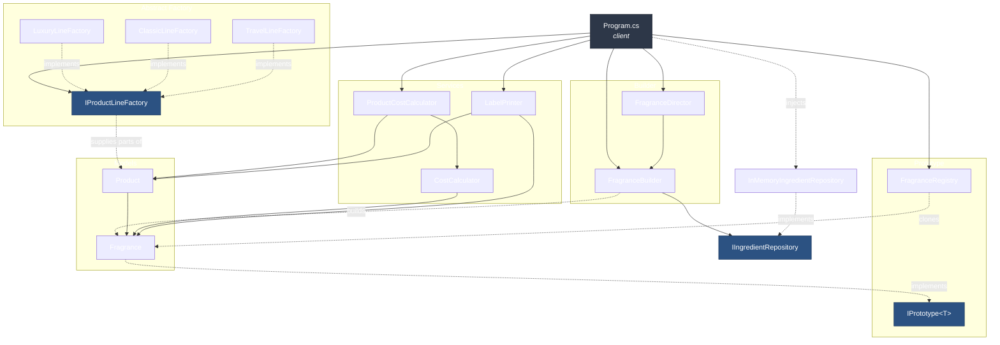
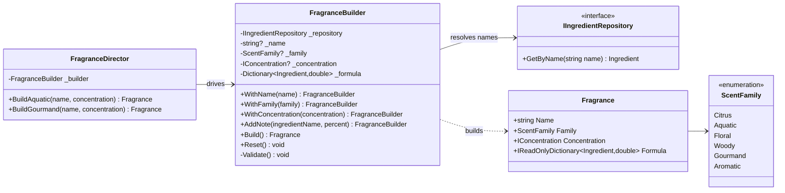
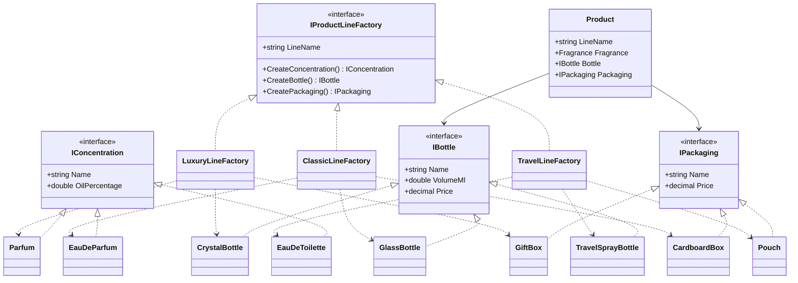
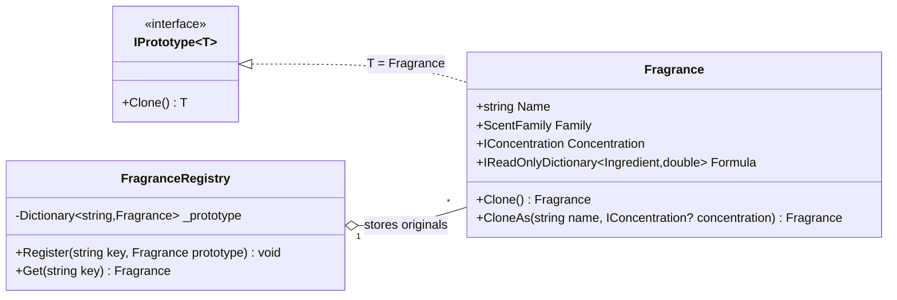
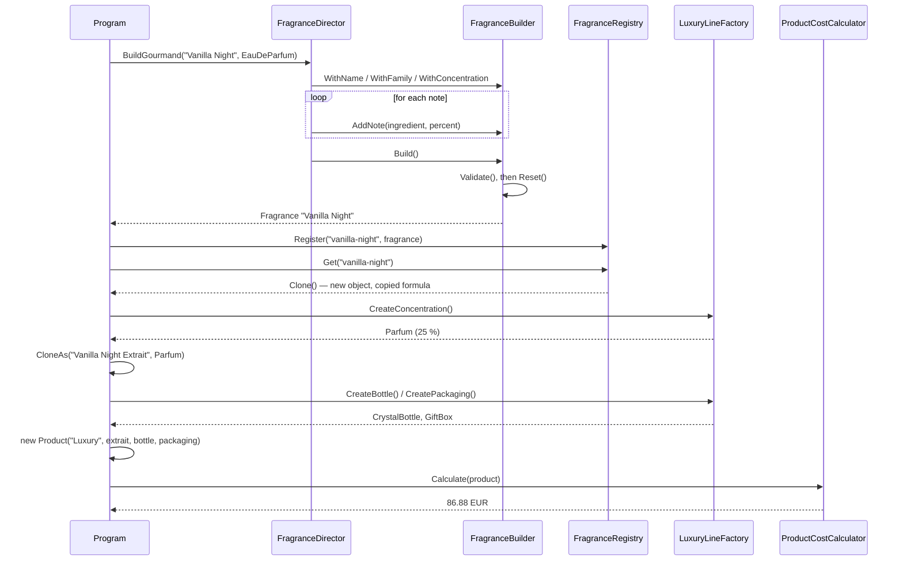

# Laboratory Work Nr. 2 — Creational Design Patterns

**Course:** TMPS — Software Design Techniques and Mechanisms
**Topic:** Implementation of creational design patterns (minimum 3)
**Project:** `FragranceComposer`
**Technology:** C# / .NET 10 (console application)
**Author:** OBERȘT Eduard FAF_243
**Repository branch:** `lab2`

---

## 1. Objectives

1. Study the creational design patterns and the object-instantiation problems they address.
2. Extend the domain from Laboratory Work Nr. 1 with entities whose creation is genuinely non-trivial, and choose an appropriate instantiation mechanism for each of them.
3. Implement **at least three** creational patterns, each one solving a real creation problem of the domain rather than being added for its own sake.
4. Keep the SOLID structure obtained in Lab 1 intact, and document the resulting architecture and design decisions.

---

## 2. The Idea — Domain Description

Lab 1 modelled a perfumer **composing** a fragrance: a formula of ingredients, each belonging to a
note layer (top / heart / base), diluted according to a concentration class. Lab 2 follows the
same fragrance one step further — **from the laboratory to the shelf**:

- a fragrance is now also classified by its **scent family** (`Citrus`, `Aquatic`, `Floral`, `Woody`, `Gourmand`, `Aromatic`);
- a finished fragrance is released as a **product** in one of several **product lines** — *Luxury*, *Classic*, *Travel* — and each line has its own concentration, bottle and packaging;
- a successful fragrance gets **variants** (in the industry: *flankers* — the *Intense*, *Extrait* or *Night* edition of an existing scent) that keep the formula and change the name or the concentration.

These additions produce three distinct creation problems, and each one is solved by a different
creational pattern:

| # | Creation problem in the domain | Why a plain `new` is not enough | Pattern |
|---|---|---|---|
| 1 | A fragrance is assembled note by note and must obey formula rules (the percentages total 100 %, top, heart and base notes are all present) | a 4-argument constructor taking a dictionary accepts *any* formula, including invalid ones, and the rules span several arguments at once | **Builder** (+ Director) |
| 2 | A product line is a *family* of parts that must match: Luxury = Parfum + crystal bottle + gift box, Travel = Eau de Toilette + 10 ml spray + pouch | the client could put Parfum in a pouch or a travel spray in a gift box, and every client would have to know every concrete component | **Abstract Factory** |
| 3 | A flanker is derived from an existing, already-approved fragrance | rebuilding the formula note by note duplicates the recipe; copying fields by hand risks sharing the formula collection between original and copy | **Prototype** (+ registry) |

The program runs five scenarios that exercise the patterns separately and then together:

1. *"Moldavian Summer"* — built directly with the **Builder** (Floral, Eau de Parfum).
2. *"Black Sea Breeze"* — the Aquatic recipe from the **Director**, released in all three product lines through the **Abstract Factory**, with the total cost of each product.
3. *"Broken"* — an invalid formula (only 90 %) that the **Builder** rejects.
4. *"Moldavian Summer Intense"* — a **Prototype** clone of scenario 1 with a stronger concentration.
5. *"Vanilla Night Extrait"* — **all three patterns in one chain**: built by the Director, stored in the registry, cloned as a variant and packaged by the Luxury line.

---

## 3. Project Structure

```
FragranceComposer/
├── Builders/                                   (new)
│   ├── FragranceBuilder.cs                     — step-by-step construction + formula validation
│   └── FragranceDirector.cs                    — predefined recipes (Aquatic, Gourmand)
├── Factories/                                  (new)
│   ├── IProductLineFactory.cs                  — abstract factory: concentration + bottle + packaging
│   ├── LuxuryLineFactory.cs                    — Parfum + Crystal bottle + Gift box
│   ├── ClassicLineFactory.cs                   — Eau de Parfum + Glass bottle + Cardboard box
│   └── TravelLineFactory.cs                    — Eau de Toilette + Travel spray bottle + Pouch
├── Prototypes/                                 (new)
│   └── FragranceRegistry.cs                    — stores originals, hands out clones
├── Components/                                 (new)
│   ├── CrystalBottle.cs                        — IBottle, 100 ml
│   ├── GlassBottle.cs                          — IBottle, 50 ml
│   ├── TravelSprayBottle.cs                    — IBottle, 10 ml
│   ├── GiftBox.cs                              — IPackaging
│   ├── CardboardBox.cs                         — IPackaging
│   └── Pouch.cs                                — IPackaging
├── Concentrations/
│   ├── EauDeToilette.cs                        — 10 % oil
│   ├── EauDeParfum.cs                          — 18 % oil
│   └── Parfum.cs                               — 25 % oil                              (new)
├── Interfaces/
│   ├── IConcentration.cs                       — abstraction over the oil-content family
│   ├── IIngredientRepository.cs                — abstraction over the ingredient catalogue
│   ├── IBottle.cs                              — name, volume, price                   (new)
│   ├── IPackaging.cs                           — name, price                           (new)
│   └── IPrototype.cs                           — generic Clone() contract              (new)
├── Models/
│   ├── Ingredient.cs                           — raw material: name, note layer, price per ml
│   ├── Fragrance.cs                            — + Family, read-only Formula, Clone   (changed)
│   ├── ScentFamily.cs                          — Citrus, Aquatic, Floral, …           (new)
│   └── Product.cs                              — fragrance + bottle + packaging        (new)
├── Repositories/
│   └── InMemoryIngredientRepository.cs         — catalogue extended to 10 ingredients  (changed)
├── Services/
│   ├── CostCalculator.cs                       — oil cost for a bottle size (unchanged)
│   ├── ProductCostCalculator.cs                — oil + bottle + packaging              (new)
│   └── LabelPrinter.cs                         — + Print(Product)                      (changed)
└── Program.cs                                  — client / demo scenarios
```

`Services/FragranceService.cs` from Lab 1 was **removed**: its only job — turning ingredient names
and percentages into a `Fragrance` — is now done by `FragranceBuilder`, which also validates the
result (see §5.1 and §5.5).

---

## 4. Architecture Diagrams

### 4.1 Component view



> Each creational group has exactly one entry point for the client: `FragranceDirector` /
> `FragranceBuilder` for *assembling* a fragrance, `IProductLineFactory` for *choosing the parts* of a
> product, `FragranceRegistry` for *deriving* a variant.

### 4.2 Builder — class diagram



### 4.3 Abstract Factory — class diagram



> Dashed arrows from a factory mean *creates*. Every concrete factory creates exactly one product of
> each kind, and those three products always belong to the same line.

### 4.4 Prototype — class diagram



### 4.5 Sequence of the combined scenario (all three patterns)



---

## 5. Implemented Creational Patterns

### 5.1 Builder (with Director)

> *Separate the construction of a complex object from its representation, so that the same
> construction process can create different representations.*

**Problem.** In Lab 1, `FragranceService.Create(name, concentration, Dictionary<string, double>)`
accepted any dictionary. A formula totalling 90 %, or one without a base note, still produced a
valid-looking `Fragrance`. In Lab 2 the constructor gained a fourth argument (`ScentFamily`), and
the domain rules involve several arguments at once. The Builder lets the client supply the parts
one at a time and checks the whole object **once, at the moment it is created**.

| GoF role | Class |
|---|---|
| Builder | `FragranceBuilder` |
| Director | `FragranceDirector` |
| Product | `Fragrance` |
| Client | `Program` |

The builder has a fluent interface: every step returns `this`, and `Build()` is the only way to get the
finished object:

```csharp
// Builders/FragranceBuilder.cs
public FragranceBuilder WithName(string name) { _name = name; return this; }
public FragranceBuilder WithFamily(ScentFamily family) { _family = family; return this; }
public FragranceBuilder WithConcentration(IConcentration concentration) { _concentration = concentration; return this; }

public FragranceBuilder AddNote(string ingredientName, double percent)
{
    if (percent <= 0)
        throw new ArgumentOutOfRangeException(nameof(percent), "Percent must be positive");
    _formula[_repository.GetByName(ingredientName)] = percent;
    return this;
}

public Fragrance Build()
{
    try
    {
        Validate();
        return new Fragrance(_name!, _family!.Value, _concentration!, _formula);
    }
    finally
    {
        Reset();
    }
}
```

The rules enforced by the builder:

| Rule | Checked in | Failure |
|---|---|---|
| ingredient exists in the catalogue | `AddNote` (via repository) | `ArgumentException: Unknown ingredient: …` |
| percentage is positive | `AddNote` | `ArgumentOutOfRangeException` |
| name is not empty | `Validate` | `Fragrance name is required` |
| scent family is set | `Validate` | `Scent family is required` |
| concentration is set | `Validate` | `Concentration is required` |
| percentages total 100 % (± 0.01) | `Validate` | `Formula must total 100%, got X%` |
| top, heart **and** base notes are all present | `Validate` | `Formula is missing a {layer} note` |

**The Director** stores the recipes that the perfume house produces repeatedly. The concentration is
a **parameter**, not part of the recipe — the same Aquatic accord can be produced as Parfum, Eau de
Parfum or Eau de Toilette. The Abstract Factory relies on exactly this in §5.2:

```csharp
// Builders/FragranceDirector.cs
public Fragrance BuildAquatic(string name, IConcentration concentration) =>
    _builder.WithName(name)
            .WithFamily(ScentFamily.Aquatic)
            .WithConcentration(concentration)
            .AddNote("Sea Notes", 20)
            .AddNote("Bergamot", 15)
            .AddNote("Lavender", 25)
            .AddNote("Musk", 25)
            .AddNote("Ambroxan", 15)
            .Build();
```

The client can also skip the Director and use the builder directly for a one-off fragrance:

```csharp
// Program.cs
var summer = builder
    .WithName("Moldavian Summer")
    .WithFamily(ScentFamily.Floral)
    .WithConcentration(new EauDeParfum())
    .AddNote("Bergamot", 25)
    .AddNote("Rose", 40)
    .AddNote("Vanilla", 35)
    .Build();
```

**Design decisions:**

- **`Build()` always resets, in a `finally` block.** One builder instance is shared by `Program` and
  the `FragranceDirector`. Scenario 3 (*"Broken"*) fails validation. Without the `finally`, its
  Lemon and Musk would still be in `_formula` when the Director builds *"Vanilla Night"* next, and that
  correct recipe would fail too.
- **`Reset()` assigns a new dictionary instead of calling `Clear()`.** The finished `Fragrance` keeps
  the dictionary it was built with, and the builder never touches that dictionary again. Clearing it would empty the
  formula of the fragrance that was just returned.
- **Name resolution goes through `IIngredientRepository`**, so the builder keeps the Dependency
  Inversion from Lab 1. It depends on the abstraction, exactly as `FragranceService` did.
- **No abstract `IFragranceBuilder`.** GoF allows several builders producing different
  representations, but this domain has a single representation (`Fragrance`). An interface with
  one implementation and no planned second one would add complexity and no benefit, which is the
  same reasoning Lab 1 used for `Ingredient` and `Fragrance`.

### 5.2 Abstract Factory

> *Provide an interface for creating families of related or dependent objects without specifying
> their concrete classes.*

**Problem.** A product line fixes three parts that must match. Mixing them, for example Parfum in
a pouch or a 10 ml travel spray in a gift box, is a real business error. If clients called
`new CrystalBottle()` themselves, nothing would prevent it, and every client would need to know
every concrete component.

The product families implemented:

| Product line | Concentration (`IConcentration`) | Bottle (`IBottle`) | Packaging (`IPackaging`) |
|---|---|---|---|
| **Luxury** | `Parfum` — 25 % oil | `CrystalBottle` — 100 ml, 18.00 € | `GiftBox` — 9.00 € |
| **Classic** | `EauDeParfum` — 18 % oil | `GlassBottle` — 50 ml, 4.00 € | `CardboardBox` — 1.20 € |
| **Travel** | `EauDeToilette` — 10 % oil | `TravelSprayBottle` — 10 ml, 1.50 € | `Pouch` — 0.50 € |

| GoF role | Class |
|---|---|
| AbstractFactory | `IProductLineFactory` |
| ConcreteFactory | `LuxuryLineFactory`, `ClassicLineFactory`, `TravelLineFactory` |
| AbstractProduct | `IConcentration`, `IBottle`, `IPackaging` |
| ConcreteProduct | `Parfum`, `EauDeParfum`, `EauDeToilette`, `CrystalBottle`, `GlassBottle`, `TravelSprayBottle`, `GiftBox`, `CardboardBox`, `Pouch` |
| Client | `Program` |

```csharp
// Factories/IProductLineFactory.cs
public interface IProductLineFactory
{
    string LineName { get; }
    IConcentration CreateConcentration();
    IBottle CreateBottle();
    IPackaging CreatePackaging();
}

// Factories/LuxuryLineFactory.cs
public class LuxuryLineFactory : IProductLineFactory
{
    public string LineName => "Luxury";
    public IConcentration CreateConcentration() => new Parfum();
    public IBottle CreateBottle() => new CrystalBottle();
    public IPackaging CreatePackaging() => new GiftBox();
}
```

The client works only with `IProductLineFactory`. The loop below releases the same recipe in all
three lines without naming a single concrete bottle, box or concentration:

```csharp
// Program.cs
IProductLineFactory[] lines =
{
    new LuxuryLineFactory(),
    new ClassicLineFactory(),
    new TravelLineFactory()
};

foreach (var line in lines)
{
    var fragrance = director.BuildAquatic("Black Sea Breeze", line.CreateConcentration());
    var product = new Product(line.LineName, fragrance, line.CreateBottle(), line.CreatePackaging());
    printer.Print(product);
    Console.WriteLine($"Total cost: {costCalculator.Calculate(product):F2} EUR\n");
}
```

The cost of a finished product is calculated by **composing** the Lab 1 calculator rather than
modifying it:

```csharp
// Services/ProductCostCalculator.cs
public decimal Calculate(Product product) =>
    _oilCalculator.Calculate(product.Fragrance, product.Bottle.VolumeMl)
    + product.Bottle.Price
    + product.Packaging.Price;
```

**Design decisions:**

- **The factory does not create the fragrance itself.** The scent does not depend on the line: the same
  *"Black Sea Breeze"* recipe goes into all three products. The factory supplies only the parts that
  must match *each other*, and the Director supplies the scent. Merging them would give one
  factory per (line × recipe) pair.
- **`IConcentration` from Lab 1 became an abstract product with no changes.** The Lab 1 report
  predicted that a 25 % concentration could be added as a new class without editing
  `CostCalculator`, `LabelPrinter` or `Fragrance`. Lab 2 added `Parfum` exactly that way, which
  confirms the Open/Closed design.
- **Trade-off.** Adding a new *line* (a row of the table above, e.g. a *Sample* line) means adding
  one factory class, with no edits to existing code. Adding a new *kind of part* (a column, e.g. an
  `IAtomizer`) means editing the interface and every factory. This is the known weakness of Abstract
  Factory. It is acceptable here because a perfume house launches new lines far more often than it
  changes what a bottle of perfume consists of.

### 5.3 Prototype (with registry)

> *Specify the kinds of objects to create using a prototypical instance, and create new objects by
> copying this prototype.*

**Problem.** A flanker is defined as *"the same fragrance, with a different name and/or
concentration"*. Building it again with the Builder would repeat every note of the recipe and run
the validation again on a formula that was already approved. Copying fields by hand at each call
site risks sharing the formula dictionary between the original and the copy. With Prototype, the
object knows how to copy itself correctly.

| GoF role | Class |
|---|---|
| Prototype | `IPrototype<T>` |
| ConcretePrototype | `Fragrance` |
| Prototype registry (manager) | `FragranceRegistry` |
| Client | `Program` |

```csharp
// Interfaces/IPrototype.cs
public interface IPrototype<T>
{
    T Clone();
}

// Models/Fragrance.cs
public class Fragrance : IPrototype<Fragrance>
{
    // … properties and constructor …

    public Fragrance Clone() => CloneAs(Name);

    public Fragrance CloneAs(string name, IConcentration? concentration = null) =>
        new Fragrance(name, Family, concentration ?? Concentration,
                      new Dictionary<Ingredient, double>(Formula));
}
```

`Clone()` is the plain GoF operation. `CloneAs()` is the operation the domain actually needs: copy
everything, then change the name and, optionally, the concentration.

**Copy depth was decided field by field**, depending on whether the field can change:

| Field | How it is copied | Why |
|---|---|---|
| `Name` | kept or replaced | `string` is immutable |
| `Family` | copied by value | `enum` |
| `Concentration` | shared or replaced | concentration objects are stateless |
| `Formula` | **new `Dictionary`** | the only collection in the object, and the clone must not share it |
| `Ingredient` keys | shared references | ingredients are immutable catalogue entries. Since `Ingredient` uses reference equality as a dictionary key, copying them would also break the link with the repository |

As part of the same change, `Fragrance.Formula` was changed from `Dictionary` to
`IReadOnlyDictionary`, so code outside the class cannot modify a formula through the property.

The registry keeps the approved originals and **never returns them**. It always returns a copy:

```csharp
// Prototypes/FragranceRegistry.cs
public class FragranceRegistry
{
    private readonly Dictionary<string, Fragrance> _prototype = new();

    public void Register(string key, Fragrance prototype) => _prototype[key] = prototype;

    public Fragrance Get(string key) =>
        _prototype.TryGetValue(key, out var prototype)
            ? prototype.Clone()
            : throw new ArgumentException($"Unknown prototype: {key}");
}
```

```csharp
// Program.cs — the independence of the copy is checked explicitly
var summerCopy = registry.Get("summer");
Console.WriteLine($"Same object as original? {ReferenceEquals(summer, summerCopy)}");            // False
Console.WriteLine($"Same formula instance? {ReferenceEquals(summer.Formula, summerCopy.Formula)}"); // False

var summerIntense = registry.Get("summer").CloneAs("Moldavian Summer Intense", new Parfum());
```

### 5.4 The patterns working together

The patterns are not three separate demos. Each one answers a different question about creating an
object, so they combine without overlapping. Scenario 5 uses all of them in one chain:

```csharp
// Program.cs
registry.Register("vanilla-night",
    director.BuildGourmand("Vanilla Night", new EauDeParfum()));     // Builder + Director

var luxury = new LuxuryLineFactory();
var extrait = registry.Get("vanilla-night")                           // Prototype
                      .CloneAs("Vanilla Night Extrait",
                               luxury.CreateConcentration());         // Abstract Factory
var extraitProduct = new Product(luxury.LineName, extrait,
                                 luxury.CreateBottle(), luxury.CreatePackaging());
```

| Question | Pattern | Answer in this project |
|---|---|---|
| *How* is a complex object assembled correctly? | Builder | note by note, validated once in `Build()` |
| *Which* objects belong together? | Abstract Factory | one factory per product line |
| *From what* is a new object derived? | Prototype | from an approved original in the registry |

### 5.5 Impact on the Lab 1 design

| Lab 1 element | Status in Lab 2 | Reason |
|---|---|---|
| `IConcentration`, `EauDeParfum`, `EauDeToilette` | unchanged | reused as products of the Abstract Factory, `Parfum` added next to them |
| `CostCalculator` | unchanged | wrapped by `ProductCostCalculator` (composition instead of modification) |
| `IIngredientRepository`, `Ingredient` | unchanged | the builder depends on the abstraction, as the old service did |
| `InMemoryIngredientRepository` | data extended | 4 → 10 ingredients, needed by the new recipes |
| `Fragrance` | changed | + `Family`; `Formula` became `IReadOnlyDictionary`; implements `IPrototype<Fragrance>` |
| `LabelPrinter` | extended | scent family in the header; new `Print(Product)` overload |
| `FragranceService` | **removed** | its responsibility moved into `FragranceBuilder`, which also validates |

The SOLID properties from Lab 1 still hold. Every new creational class has a single responsibility.
Product lines and concentrations grow by adding classes. The high-level code still depends on
`IIngredientRepository`, `IConcentration`, `IBottle` and `IPackaging`, not on their implementations.

---

## 6. Results

Build and run:

```bash
dotnet run --project FragranceComposer
```

Actual program output:

```
===Moldavian Summer(Eau de Parfum,Floral)===
Top note: Bergamot 25%
Heart note: Rose 40%
Base note: Vanilla 35%

[Luxury line]
===Black Sea Breeze(Parfum,Aquatic)===
Top note: Sea Notes 20%
Top note: Bergamot 15%
Heart note: Lavender 25%
Base note: Musk 25%
Base note: Ambroxan 15%
Bottle: Crystal bottle (100 ml)
Packaging: Gift box
Total cost: 61.00 EUR

[Classic line]
===Black Sea Breeze(Eau de Parfum,Aquatic)===
Top note: Sea Notes 20%
Top note: Bergamot 15%
Heart note: Lavender 25%
Base note: Musk 25%
Base note: Ambroxan 15%
Bottle: Glass bottle (50 ml)
Packaging: Cardboard box
Total cost: 17.44 EUR

[Travel line]
===Black Sea Breeze(Eau de Toilette,Aquatic)===
Top note: Sea Notes 20%
Top note: Bergamot 15%
Heart note: Lavender 25%
Base note: Musk 25%
Base note: Ambroxan 15%
Bottle: Travel spray bottle (10 ml)
Packaging: Pouch
Total cost: 3.36 EUR

BUILD REJECTED: Formula must total 100%, got 90%

--- Prototype ---
Same object as original? False
Same formula instance? False
===Moldavian Summer Intense(Parfum,Floral)===
Top note: Bergamot 25%
Heart note: Rose 40%
Base note: Vanilla 35%
Original unchanged: Moldavian Summer (Eau de Parfum)

[Luxury line]
===Vanilla Night Extrait(Parfum,Gourmand)===
Top note: Bergamot 15%
Heart note: Jasmine 25%
Base note: Vanilla 40%
Base note: Sandalwood 20%
Bottle: Crystal bottle (100 ml)
Packaging: Gift box
Total cost: 86.88 EUR
```

What each part of the output demonstrates:

| Output | Pattern | Shows that… |
|---|---|---|
| *Moldavian Summer* label | Builder | a fragrance built step by step passes validation |
| three *Black Sea Breeze* products | Abstract Factory + Director | one recipe, three lines, and each line gets its own matching concentration, bottle and packaging |
| `BUILD REJECTED: … got 90%` | Builder | an invalid formula is never turned into an object. (It is also missing a heart note, but the 100 % check runs first.) |
| `Same object… False`, `Same formula instance? False` | Prototype | the registry returns a new object with its own formula collection |
| `Original unchanged: … (Eau de Parfum)` | Prototype | cloning a variant with Parfum does not affect the registered original |
| *Vanilla Night Extrait* product | all three | the patterns compose in one chain |

Verification of the computed costs — reproducible by hand. Cost of 1 ml of the *Black Sea Breeze*
oil blend:

| Ingredient | Share | Price | Contribution |
|---|---|---|---|
| Sea Notes | 20 % | 1.20 €/ml | 0.240 € |
| Bergamot | 15 % | 0.80 €/ml | 0.120 € |
| Lavender | 25 % | 1.00 €/ml | 0.250 € |
| Musk | 25 % | 1.50 €/ml | 0.375 € |
| Ambroxan | 15 % | 2.50 €/ml | 0.375 € |
| **Blend** | 100 % | | **1.360 €/ml** |

| Line | Bottle | Oil fraction | Oil volume | Oil cost | Bottle | Packaging | **Total** |
|---|---|---|---|---|---|---|---|
| Luxury | 100 ml | 25 % | 25 ml | 34.00 € | 18.00 € | 9.00 € | **61.00 €** |
| Classic | 50 ml | 18 % | 9 ml | 12.24 € | 4.00 € | 1.20 € | **17.44 €** |
| Travel | 10 ml | 10 % | 1 ml | 1.36 € | 1.50 € | 0.50 € | **3.36 €** |

*Vanilla Night Extrait* (Luxury): blend = Bergamot 15 % × 0.80 + Jasmine 25 % × 3.50 + Vanilla
40 % × 2.00 + Sandalwood 20 % × 3.00 = **2.395 €/ml**. 25 ml × 2.395 = 59.875 €, + 18.00 € bottle
+ 9.00 € gift box = 86.875 €, printed as **86.88 €** after rounding to two decimals.

---

## 7. Conclusions

The laboratory work extends the Lab 1 application with three creational patterns, each chosen
because the domain had a concrete instantiation problem that a plain constructor call could not
solve well:

- **Builder** made object creation a validated process. A `Fragrance` whose formula does not total
  100 % or lacks a note layer is rejected in `Build()` and never reaches the rest of the program. The
  `Director` captures the house recipes once and leaves the concentration open. The `finally`-based
  reset makes one builder instance safe to reuse after a failed build.
- **Abstract Factory** guarantees that the parts of a product match. The client releases the same
  fragrance in three lines without naming a concrete bottle, box or concentration, and adding a fourth
  line requires one new class. The `IConcentration` abstraction from Lab 1 became one of the factory's
  products without any change, and `Parfum` was added purely by addition.
- **Prototype** made variants cheap and safe. A flanker is one `CloneAs` call on an approved original
  from the registry, and the output confirms that the copy is a different object with its own formula
  and that the original is untouched.

The main lesson of the work is that creational patterns are about *who decides how an object comes
into existence*. Each pattern took that decision away from the client for one specific reason:
correctness (Builder), consistency between related objects (Abstract Factory), and reuse of an
approved object (Prototype). Because they answer different questions, they combine naturally, and
the final scenario uses all three in a single expression.

Two more observations connect this work with Lab 1. First, the Prototype was cheap to implement
because the Lab 1 model objects were already immutable. Only the formula collection had to be
copied, while ingredients and concentrations could safely be shared, so an earlier design decision
directly reduced the cost of a later pattern. Second, as in Lab 1, part of the work was deciding
where *not* to add an abstraction. There is no abstract builder, because there is only one product
representation. There is no factory for the fragrance itself, because the scent does not depend on
the product line. Each pattern was applied only where the domain actually varies.
