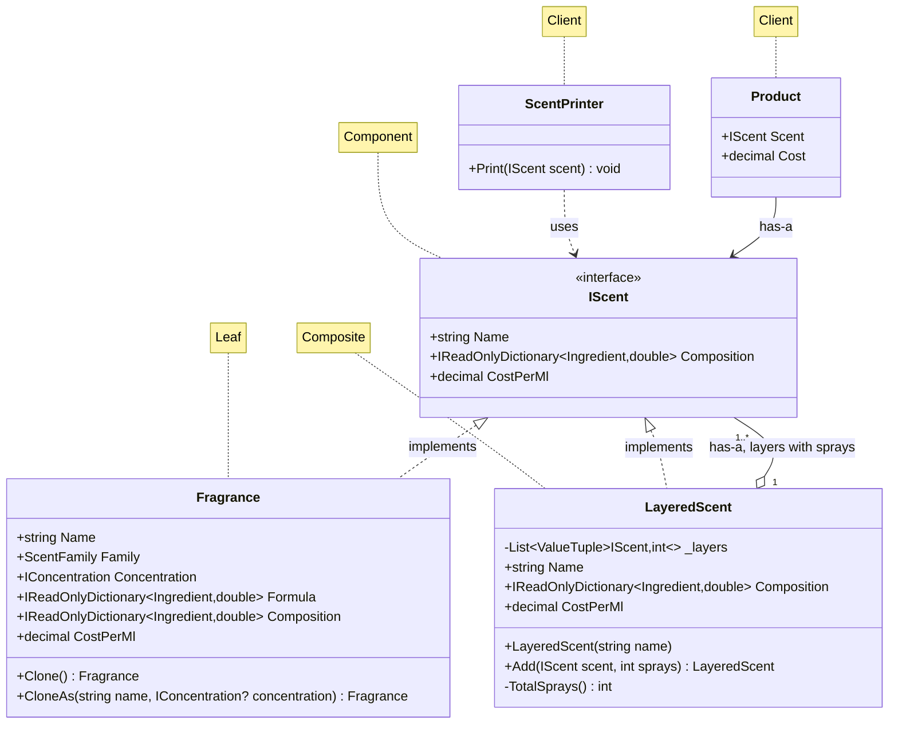
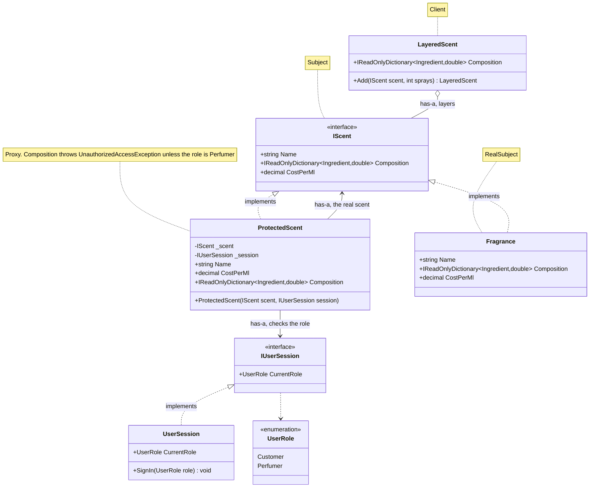
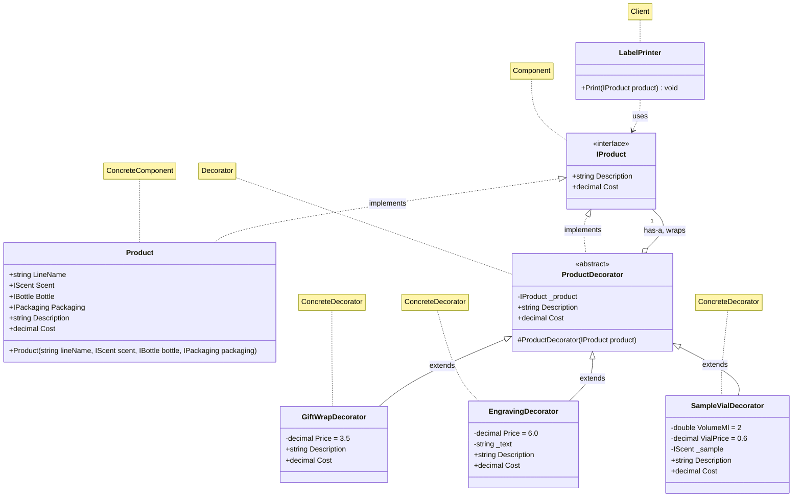
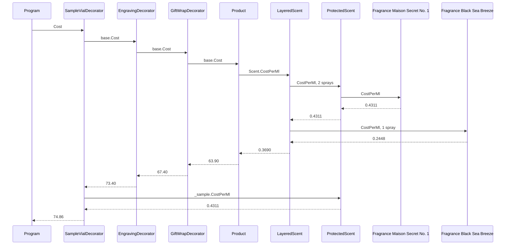

# Laboratory Work Nr. 3. Structural Design Patterns

Course: TMPS, Software Design Techniques and Mechanisms\
Topic: Implementation of structural design patterns\
Project: `FragranceComposer`\
Technology: C# / .NET 10 console application, xUnit for unit tests\
Author: Oberșt Eduard, FAF-243\
Repository branch: `lab3`

---

## 1. Objectives

1. Study the structural design patterns and the problems they solve when objects are combined into bigger structures.
2. Extend the FragranceComposer domain from Labs 1 and 2 with three structural patterns, each one solving a real problem of the domain.
3. Connect the patterns on one execution path, with client code that depends only on abstractions.
4. Prove the key property of every pattern with unit tests that run with `dotnet test`.

---

## 2. Domain Description

FragranceComposer is a console application that models the work of a small perfume house. A perfumer composes a fragrance from ingredients, and every ingredient belongs to the top, heart or base notes and has a price per ml. The finished fragrance is released as a product in the Luxury, Classic or Travel line, and each line has its own concentration, bottle and packaging. Lab 1 added the formula and its cost, and Lab 2 added the Builder, Abstract Factory and Prototype patterns for creating fragrances and products.

This laboratory work adds fragrance layering, which means wearing two or more fragrances at the same time to get a new scent. A real example is Maison Margiela Sailing Day layered with Never Ending Summer. Layering brings three new situations into the domain, and each of them is solved by one structural pattern.

| # | Situation in the domain | Pattern | Main classes |
|---|---|---|---|
| 1 | A layered scent is made of fragrances or of other layered scents, but a product or a printer should use it like one fragrance | Composite | `IScent`, `Fragrance`, `LayeredScent` |
| 2 | The formula of a signature fragrance is a trade secret. Everyone can see its name and price, but only a perfumer can read the composition | Proxy | `ProtectedScent`, `IUserSession` |
| 3 | A customer can add gift wrap, an engraving or a sample vial to a product in any combination, and each add-on changes the description and the price | Decorator | `IProduct`, `ProductDecorator` and three add-ons |

The program shows the patterns in three new sections of `Program.cs`. Section 5 builds two layered scents, Beach Evening and Weekend Ritual, where the second one contains the first. Section 6 protects a secret fragrance, Maison Secret No. 1, and shows what a customer and a perfumer can see. Section 7 sells a layered scent that contains the secret as a Luxury product and adds gift wrap, an engraving and a sample vial to it.

---

## 3. Project Structure

```
FragranceComposer/
├── Builders/            FragranceBuilder, FragranceDirector              (unchanged, Lab 2)
├── Factories/           IProductLineFactory + 3 line factories           (unchanged, Lab 2)
├── Prototypes/          FragranceRegistry                                (unchanged, Lab 2)
├── Components/          bottles and packaging                            (unchanged, Lab 2)
├── Concentrations/      EauDeToilette, EauDeParfum, Parfum               (unchanged)
├── Repositories/        InMemoryIngredientRepository                     (unchanged)
├── Composites/                                                           (new)
│   └── LayeredScent.cs           composite of (IScent, sprays) layers
├── Proxies/                                                              (new)
│   └── ProtectedScent.cs         hides the composition of a secret scent
├── Decorators/                                                           (new)
│   ├── ProductDecorator.cs       abstract base, forwards to the wrapped IProduct
│   ├── GiftWrapDecorator.cs      + 3.50 EUR
│   ├── EngravingDecorator.cs     + 6.00 EUR, custom text
│   └── SampleVialDecorator.cs    + 2 ml of another scent + 0.60 EUR vial
├── Interfaces/
│   ├── IScent.cs                 name, composition, cost per ml          (new)
│   ├── IUserSession.cs           role of the current user                (new)
│   ├── Product.cs                IProduct, description and cost          (new)
│   └── ...                       IConcentration, IBottle, IPackaging ... (unchanged)
├── Models/
│   ├── Fragrance.cs              now also implements IScent              (changed)
│   ├── Product.cs                holds an IScent, implements IProduct    (changed)
│   ├── UserRole.cs               Customer, Perfumer                      (new)
│   └── ...                       Ingredient, NoteLayer, ScentFamily      (unchanged)
├── Services/
│   ├── ScentPrinter.cs           prints any IScent                       (new)
│   ├── UserSession.cs            IUserSession with SignIn(role)          (new)
│   ├── LabelPrinter.cs           Print(Product) became Print(IProduct)   (changed)
│   ├── CostCalculator.cs                                                 (removed)
│   └── ProductCostCalculator.cs                                          (removed)
└── Program.cs                    demo sections 5, 6 and 7 added          (changed)
FragranceComposer.Tests/                                                  (new)
├── CompositeTests.cs             4 tests
├── ProxyTests.cs                 3 tests
├── DecoratorTests.cs             3 tests
└── FragranceComposer.Tests.csproj
FragranceComposer.slnx            test project added                      (changed)
```

`CostCalculator` and `ProductCostCalculator` from Lab 2 were removed. Both of them accepted only a `Fragrance`, so they could not price a layered scent. The same formula now lives in `IScent.CostPerMl`, where every kind of scent calculates its own price per ml, and in `Product.Cost`, which adds the bottle and the packaging. The Lab 2 scenarios still print 61.00, 17.44, 3.36 and 86.88 EUR, the same totals as in the Lab 2 report.

---

## 4. Implemented Structural Patterns

Each pattern below has the problem it solves, a table of GoF roles, a class diagram, the code where the pattern is best seen and its unit tests. In the class diagrams, a dashed line with a hollow triangle means implements, a solid line with a hollow triangle means extends, and a line with a diamond means has-a. The notes next to the classes show the GoF role of each class.

### 4.1 Composite

#### Problem

A layered scent is described by its layers and by the number of sprays of each one. A layer is usually one fragrance, but it can also be another layered scent. For example, Weekend Ritual in the demo is three sprays of Beach Evening, which is already a layering of two fragrances, plus one spray of Moldavian Summer. `Product`, `ScentPrinter` and the cost calculation should not care which of these cases they get. Composite solves this by giving the single fragrance and the group the same interface, `IScent`, so the group can answer every question by asking its layers.

| GoF role | Class | Responsibility here |
|---|---|---|
| Component | `IScent` | Name, composition and cost per ml of anything that can be worn |
| Leaf | `Fragrance` | Returns its own formula and calculates its own cost per ml |
| Composite | `LayeredScent` | Stores `(IScent, sprays)` layers and combines their compositions and costs |
| Client | `Product`, `ScentPrinter`, `Program` | Use `IScent` and do not know if it is one fragrance or a group |

#### Class diagram



#### Code

[FragranceComposer/Composites/LayeredScent.cs, lines 22-39](FragranceComposer/Composites/LayeredScent.cs#L22-L39)

```csharp
    public IReadOnlyDictionary<Ingredient, double> Composition
    {
        get
        {
            int total = TotalSprays();
            var combined = new Dictionary<Ingredient, double>();
            foreach (var (scent,sprays) in _layers)
            foreach(var note in scent.Composition)
            combined[note.Key] = combined.GetValueOrDefault(note.Key)+note.Value*sprays/total;
            return combined;
        }
    }

    public decimal CostPerMl => _layers.Sum(l => l.Scent.CostPerMl*l.Sprays)/TotalSprays();
    private int TotalSprays()=>
    _layers.Count >0
    ? _layers.Sum(l => l.Sprays)
    : throw new InvalidOperationException($"Layered scent '{Name}' has no layers");
```

`LayeredScent` reads `Composition` and `CostPerMl` of its layers only through `IScent`, so a layer that is another `LayeredScent` runs the same code one level lower and nesting works without any type checks. Each note is multiplied by the share of sprays of its layer, so the combined composition still totals 100%, and an ingredient that appears in several layers, like Bergamot, is merged into one entry.

#### Unit tests

| Test | What it checks |
|---|---|
| `LeafAndComposite_AreUsedThroughTheSameInterface` | The same helper method, which accepts an `IScent`, gets a 100% total from a single `Fragrance` and from a `LayeredScent`. The leaf and the composite are used in exactly the same way. |
| `Composite_WeightsCompositionAndCostBySprays` | With 2 sprays of the aquatic and 1 spray of the gourmand, Sea Notes become 20 × 2/3 = 13.33%, Vanilla becomes 40 × 1/3 = 13.33%, Bergamot from both layers is merged into one entry of 15%, and the cost per ml is the weighted average of the two costs. |
| `Composite_CanContainAnotherComposite` | A layered scent inside another layered scent gives the aquatic a share of 1/2 × 1/2 + 1/2 = 3/4 and the gourmand 1/4 of the cost, and the composition still totals 100%. |
| `EmptyComposite_Throws` | A `LayeredScent` without layers throws `InvalidOperationException` for both `Composition` and `CostPerMl` instead of dividing by zero. |

Test log. The build and discovery lines are left out here and in the next sections.

```
$ dotnet test --filter "FullyQualifiedName~CompositeTests" --logger "console;verbosity=normal"
  Passed FragranceComposer.Tests.CompositeTests.Composite_WeightsCompositionAndCostBySprays [44 ms]
  Passed FragranceComposer.Tests.CompositeTests.EmptyComposite_Throws [2 ms]
  Passed FragranceComposer.Tests.CompositeTests.LeafAndComposite_AreUsedThroughTheSameInterface [< 1 ms]
  Passed FragranceComposer.Tests.CompositeTests.Composite_CanContainAnotherComposite [< 1 ms]
Test Run Successful.
Total tests: 4
     Passed: 4
 Total time: 1.9557 Seconds
```

### 4.2 Proxy

#### Problem

A perfume house keeps the formula of its signature fragrance secret. A customer still needs the name and the price, and a layered scent or a product needs the cost per ml to calculate its own price. Only a perfumer can see which ingredients are inside and in what percentages. Putting a role check inside `Fragrance` would mix an access rule with the domain model and break the Single Responsibility Principle from Lab 1. The Proxy keeps the check in a separate class with the same interface as the real scent, so the classes that use scents do not change. This kind of proxy is called a protection proxy.

| GoF role | Class | Responsibility here |
|---|---|---|
| Subject | `IScent` | The interface shared by the proxy and the real scent |
| RealSubject | `Fragrance` | The secret fragrance, Maison Secret No. 1 in the demo. Any `IScent` can be wrapped |
| Proxy | `ProtectedScent` | Passes `Name` and `CostPerMl` through and checks the role before `Composition` |
| Used by the proxy | `IUserSession`, `UserSession`, `UserRole` | Tell the proxy who is signed in |
| Client | `LayeredScent`, `ScentPrinter`, `SampleVialDecorator`, `Program` | Use the protected scent as a normal `IScent` |

#### Class diagram



#### Code

[FragranceComposer/Proxies/ProtectedScent.cs, lines 5-28](FragranceComposer/Proxies/ProtectedScent.cs#L5-L28)

```csharp
public class ProtectedScent : IScent
{
    private readonly IScent _scent;
    private readonly IUserSession _session;

    public ProtectedScent(IScent scent, IUserSession session)
    {
        _scent = scent;
        _session = session;
    }

    public string Name => _scent.Name;
    public decimal CostPerMl => _scent.CostPerMl;

    public IReadOnlyDictionary<Ingredient, double> Composition
    {
        get
        {
            if (_session.CurrentRole != UserRole.Perfumer)
            throw new UnauthorizedAccessException($"The formula of '{_scent.Name}' is secret; {_session.CurrentRole} cannot read it");
            return _scent.Composition;
        }
    }
}
```

`Name` and `CostPerMl` go straight to the real scent, but `Composition` first asks `IUserSession` for the current role and throws `UnauthorizedAccessException` if the user is not a perfumer. Because `ProtectedScent` implements the same `IScent` interface as `Fragrance`, the classes that use it cannot tell the difference, and a perfumer gets the original dictionary with no copy or change.

#### Unit tests

| Test | What it checks |
|---|---|
| `Customer_CanReadNameAndCost_ButNotComposition` | Signed in as a customer, the proxy returns the same name and cost per ml as the real scent, and reading `Composition` throws `UnauthorizedAccessException`. |
| `Perfumer_GetsTheRealCompositionUnchanged` | Signed in as a perfumer, the proxy returns the same dictionary object as the real scent (`Assert.Same`), so an authorized call is passed through without changes. |
| `CompositeContainingProxy_HidesCompositionButStillGivesCost` | A layered scent that contains the proxy still gives its cost per ml to a customer, but its composition is blocked. For a perfumer the same layered scent returns a composition that totals 100%. |

```
$ dotnet test --filter "FullyQualifiedName~ProxyTests" --logger "console;verbosity=normal"
  Passed FragranceComposer.Tests.ProxyTests.Customer_CanReadNameAndCost_ButNotComposition [47 ms]
  Passed FragranceComposer.Tests.ProxyTests.CompositeContainingProxy_HidesCompositionButStillGivesCost [13 ms]
  Passed FragranceComposer.Tests.ProxyTests.Perfumer_GetsTheRealCompositionUnchanged [< 1 ms]
Test Run Successful.
Total tests: 3
     Passed: 3
 Total time: 1.9272 Seconds
```

The third test covers a case that is easy to miss. If a customer could read the composition of a layered scent that contains the secret, they could subtract the public formula of the other fragrance and get the secret formula back. Because `LayeredScent` reads every layer through `IScent`, the check in the proxy runs for the whole layered scent too.

### 4.3 Decorator

#### Problem

When a customer buys a perfume, they can add gift wrap, an engraving on the bottle or a 2 ml sample vial of another scent. Any combination is possible, and every add-on changes both the description and the price. One subclass of `Product` for every combination would already need 7 classes for 3 add-ons, and the number doubles with each new add-on. Boolean flags inside `Product` would mean editing `Product` every time the shop offers a new service. A decorator wraps the product, adds one thing and passes the rest of the work to the wrapped object, so the add-ons are combined at runtime.

| GoF role | Class | Responsibility here |
|---|---|---|
| Component | `IProduct` | Description and cost of anything that can be sold |
| ConcreteComponent | `Product` | A scent, a bottle and packaging from a product line factory |
| Decorator | `ProductDecorator` | Abstract base. Holds the wrapped `IProduct` and forwards both properties to it |
| ConcreteDecorator | `GiftWrapDecorator`, `EngravingDecorator`, `SampleVialDecorator` | Each adds the text and the price of one add-on |
| Client | `LabelPrinter`, `Program` | Print and price any `IProduct`, plain or decorated |

#### Class diagram



#### Code

[FragranceComposer/Decorators/ProductDecorator.cs, lines 4-15](FragranceComposer/Decorators/ProductDecorator.cs#L4-L15)

```csharp
public abstract class ProductDecorator : IProduct
{
    private readonly IProduct _product;

    protected ProductDecorator(IProduct product)
    {
        _product = product;
    }

    public virtual string Description => _product.Description;
    public virtual decimal Cost => _product.Cost;
}
```

[FragranceComposer/Decorators/SampleVialDecorator.cs, lines 5-18](FragranceComposer/Decorators/SampleVialDecorator.cs#L5-L18)

```csharp
public class SampleVialDecorator : ProductDecorator
{
    private const double VolumeMl = 2;
    private const decimal VialPrice = 0.6m;
    private readonly IScent _sample;

    public SampleVialDecorator(IProduct product, IScent sample) : base(product)
    {
        _sample = sample;
    }

    public override string Description => base.Description + $" + {VolumeMl} ml sample of {_sample.Name}";
    public override decimal Cost => base.Cost + (decimal)VolumeMl * _sample.CostPerMl + VialPrice;
}
```

`ProductDecorator` keeps the wrapped `IProduct` and by default only passes `Description` and `Cost` to it. `SampleVialDecorator` overrides both, calls `base` to get the result of everything it wraps and then adds its own text and price, and the other two decorators work the same way, which is why they can be stacked in any number and in any order.

#### Unit tests

| Test | What it checks |
|---|---|
| `Decorators_StackedInAnyOrder_GiveTheSameCost` | The same three add-ons stacked in two different orders give the same cost, equal to the product cost + 3.50 + 6.00 + (2 ml × cost per ml + 0.60). Both descriptions contain all three add-ons. |
| `Decorator_AddsItsOwnPriceAndTextToTheWrappedProduct` | One gift wrap adds exactly 3.50 EUR, and the new description starts with the description of the wrapped product and ends with the gift wrap text. |
| `DecoratedProduct_OverCompositeAndProxy_IsPricedForaACosutumer` | The whole path decorator → `Product` → `LayeredScent` → `ProtectedScent` works for a customer. The gift-wrapped product is priced correctly, while the composition of the layered scent stays hidden. |

```
$ dotnet test --filter "FullyQualifiedName~DecoratorTests" --logger "console;verbosity=normal"
  Passed FragranceComposer.Tests.DecoratorTests.Decorator_AddsItsOwnPriceAndTextToTheWrappedProduct [45 ms]
  Passed FragranceComposer.Tests.DecoratorTests.DecoratedProduct_OverCompositeAndProxy_IsPricedForaACosutumer [14 ms]
  Passed FragranceComposer.Tests.DecoratorTests.Decorators_StackedInAnyOrder_GiveTheSameCost [2 ms]
Test Run Successful.
Total tests: 3
     Passed: 3
 Total time: 1.9533 Seconds
```

The cost is the same in any order because every add-on only adds an amount to the cost of the product it wraps. The description does change with the order, because each decorator appends its text at the end. This is why the first test checks that every add-on is present in the description and does not compare the two descriptions directly.

---

## 5. How the Patterns Work Together

The three patterns are connected on one execution path. When the client asks a decorated product for its cost, the call goes through the decorators to `Product`, then to the composite `LayeredScent`, then to the proxy `ProtectedScent` and finally to the `Fragrance` objects. The diagram below shows this call for the product from section 7 of `Program.cs`, with the real values.



The client code builds this structure using only the interfaces `IScent` and `IProduct`.

[FragranceComposer/Program.cs, lines 115-119 and 142-149](FragranceComposer/Program.cs#L115-L149)

```csharp
var session = new UserSession();
IScent secret = new ProtectedScent(registry.Get("vanilla-night").CloneAs("Maison Secret No. 1"), session);
IScent secretEvening = new LayeredScent("Secret Evening")
.Add(secret, 2)
.Add(seaBreeze, 1);
// ...
session.SignIn(UserRole.Customer);
IProduct plain = new Product(luxury.LineName, secretEvening, luxury.CreateBottle(), luxury.CreatePackaging());
printer.Print(plain);

IProduct gift = new GiftWrapDecorator(plain);
gift = new EngravingDecorator(gift, "For Ana");
gift = new SampleVialDecorator(gift, secret);
printer.Print(gift);
```

Each object on the path knows only the interface of the next one. The decorators know `IProduct`, `Product` knows `IScent`, and `LayeredScent` knows `IScent` again for its layers. Because of this, the proxy can sit inside the composite and the composite can sit inside a decorated product without any of these classes knowing about each other. A new add-on, a new kind of scent or a new access rule is added as a new class, and the existing ones stay the same.

The creational patterns from Lab 2 are reused on the same path. `FragranceDirector` builds Black Sea Breeze and Vanilla Night, `FragranceRegistry` returns the clone of Vanilla Night that becomes Maison Secret No. 1, and `LuxuryLineFactory` supplies the crystal bottle and the gift box of the product. The table below shows how the earlier labs were affected.

| Element from Lab 1 or 2 | Status in Lab 3 | Reason |
|---|---|---|
| `FragranceBuilder`, `FragranceDirector` | unchanged, reused | build the leaf fragrances |
| `FragranceRegistry`, `Fragrance.CloneAs` | unchanged, reused | Maison Secret No. 1 is a clone of Vanilla Night |
| `IProductLineFactory` and the line factories | unchanged, reused | supply the bottle and packaging of the decorated product |
| `Fragrance` | changed | implements `IScent`, adds `Composition` and `CostPerMl`. It is still immutable |
| `Product` | changed | holds an `IScent` instead of a `Fragrance` and implements `IProduct` |
| `LabelPrinter` | changed | `Print(Product)` became `Print(IProduct)`, so it also prints decorated products |
| `CostCalculator`, `ProductCostCalculator` | removed | they accepted only a `Fragrance`. The formula moved to `IScent.CostPerMl` and `Product.Cost` |

---

## 6. Results

### 6.1 Program output

```bash
dotnet run --project FragranceComposer
```

The first part of the output comes from the Lab 2 scenarios. It prints the same totals as in the Lab 2 report, so only the new sections 5, 6 and 7 are shown here.

```
--- Composite ---
=== Black Sea Breeze ===
Top note: Sea Notes 20.0%
Top note: Bergamot 15.0%
Heart note: Lavender 25.0%
Base note: Musk 25.0%
Base note: Ambroxan 15.0%
Composition total: 100.0%
Cost per ml: 0.2448 EUR

=== Beach Evening ===
Top note: Bergamot 15.0%
Top note: Sea Notes 13.3%
Heart note: Lavender 16.7%
Heart note: Jasmine 8.3%
Base note: Musk 16.7%
Base note: Vanilla 13.3%
Base note: Ambroxan 10.0%
Base note: Sandalwood 6.7%
Composition total: 100.0%
Cost per ml: 0.3069 EUR

=== Weekend Ritual ===
Top note: Bergamot 17.5%
Top note: Sea Notes 10.0%
Heart note: Lavender 12.5%
Heart note: Rose 10.0%
Heart note: Jasmine 6.2%
Base note: Vanilla 18.8%
Base note: Musk 12.5%
Base note: Ambroxan 7.5%
Base note: Sandalwood 5.0%
Composition total: 100.0%
Cost per ml: 0.3427 EUR

--- Proxy ---
[signed in as Customer]
Maison Secret No. 1 costs 0.4311 EUR per ml
=== Maison Secret No. 1 ===
ACCESS DENIED: The formula of 'Maison Secret No. 1' is secret; Customer cannot read it

Secret Evening costs 0.3690 EUR per ml
=== Secret Evening ===
ACCESS DENIED: The formula of 'Maison Secret No. 1' is secret; Customer cannot read it

[signed in as Perfumer]
Maison Secret No. 1 costs 0.4311 EUR per ml
=== Maison Secret No. 1 ===
Top note: Bergamot 15.0%
Heart note: Jasmine 25.0%
Base note: Vanilla 40.0%
Base note: Sandalwood 20.0%
Composition total: 100.0%
Cost per ml: 0.4311 EUR

Secret Evening costs 0.3690 EUR per ml
=== Secret Evening ===
Top note: Bergamot 15.0%
Top note: Sea Notes 6.7%
Heart note: Jasmine 16.7%
Heart note: Lavender 8.3%
Base note: Vanilla 26.7%
Base note: Sandalwood 13.3%
Base note: Musk 8.3%
Base note: Ambroxan 5.0%
Composition total: 100.0%
Cost per ml: 0.3690 EUR

--- Decorator ---
Product: Secret Evening [Luxury line]: Crystal bottle (100 ml), Gift box
Total cost: 63.90 EUR
Product: Secret Evening [Luxury line]: Crystal bottle (100 ml), Gift box +gift wrap + engraving "For Ana" + 2 ml sample of Maison Secret No. 1
Total cost: 74.86 EUR
Product: Secret Evening [Luxury line]: Crystal bottle (100 ml), Gift box + 2 ml sample of Maison Secret No. 1 + engraving "For Ana" +gift wrap
Total cost: 74.86 EUR
Same cost in any order? True
```

| Output | Pattern | What it shows |
|---|---|---|
| Black Sea Breeze, Beach Evening and Weekend Ritual printed by the same `ScentPrinter` | Composite | A fragrance, a layered scent and a layered scent inside another one go through the same `IScent` code, and every composition totals 100% |
| Bergamot 15.0% in Beach Evening | Composite | Bergamot from both layers is merged into one entry |
| ACCESS DENIED for the customer, the full formula for the perfumer | Proxy | Only the composition is blocked. The cost per ml is the same for both roles |
| ACCESS DENIED for Secret Evening | Proxy and Composite | A layered scent that contains the secret cannot be used to read it |
| 63.90 EUR, then 74.86 EUR for both orders | Decorator | Add-ons in two different orders give the same total, while the description follows the order of wrapping |

### 6.2 Checking the price by hand

Maison Secret No. 1 is a clone of Vanilla Night in Eau de Parfum. Its oil blend costs 15% × 0.80 + 25% × 3.50 + 40% × 2.00 + 20% × 3.00 = 2.395 EUR per ml of oil, and with 18% oil this gives 0.4311 EUR per ml of perfume. Black Sea Breeze in Eau de Parfum costs 18% × 1.36 = 0.2448 EUR per ml. The decorated product is then calculated step by step.

| Step | Calculation | Result |
|---|---|---|
| Secret Evening, 2 sprays + 1 spray | (2 × 0.4311 + 1 × 0.2448) / 3 | 0.3690 EUR/ml |
| Product in the Luxury line | 100 ml × 0.3690 + 18.00 bottle + 9.00 gift box | 63.90 EUR |
| + gift wrap | 63.90 + 3.50 | 67.40 EUR |
| + engraving | 67.40 + 6.00 | 73.40 EUR |
| + sample vial | 73.40 + 2 ml × 0.4311 + 0.60 | 74.86 EUR |

### 6.3 All unit tests

```
$ dotnet test --logger "console;verbosity=normal"
Starting test execution, please wait...
A total of 1 test files matched the specified pattern.
[xUnit.net 00:00:00.01] xUnit.net VSTest Adapter v3.1.4+50e68bbb8b (64-bit .NET 10.0.15)
[xUnit.net 00:00:00.22]   Discovering: FragranceComposer.Tests
[xUnit.net 00:00:00.33]   Discovered:  FragranceComposer.Tests
[xUnit.net 00:00:00.39]   Starting:    FragranceComposer.Tests
  Passed FragranceComposer.Tests.ProxyTests.Customer_CanReadNameAndCost_ButNotComposition [54 ms]
  Passed FragranceComposer.Tests.DecoratorTests.Decorator_AddsItsOwnPriceAndTextToTheWrappedProduct [53 ms]
  Passed FragranceComposer.Tests.CompositeTests.Composite_WeightsCompositionAndCostBySprays [50 ms]
  Passed FragranceComposer.Tests.ProxyTests.CompositeContainingProxy_HidesCompositionButStillGivesCost [1 ms]
  Passed FragranceComposer.Tests.CompositeTests.EmptyComposite_Throws [1 ms]
  Passed FragranceComposer.Tests.DecoratorTests.DecoratedProduct_OverCompositeAndProxy_IsPricedForaACosutumer [1 ms]
  Passed FragranceComposer.Tests.ProxyTests.Perfumer_GetsTheRealCompositionUnchanged [< 1 ms]
  Passed FragranceComposer.Tests.CompositeTests.LeafAndComposite_AreUsedThroughTheSameInterface [< 1 ms]
[xUnit.net 00:00:00.68]   Finished:    FragranceComposer.Tests
  Passed FragranceComposer.Tests.CompositeTests.Composite_CanContainAnotherComposite [< 1 ms]
  Passed FragranceComposer.Tests.DecoratorTests.Decorators_StackedInAnyOrder_GiveTheSameCost [3 ms]

Test Run Successful.
Total tests: 10
     Passed: 10
 Total time: 2.0465 Seconds
```

All 10 tests pass. A plain `dotnet test` runs the same tests. The logger option only makes the output list every test by name.

---

## 7. Conclusions

In this laboratory work I added three structural patterns to FragranceComposer. Composite lets a layered scent be used in the same way as a single fragrance, even when one layered scent is inside another. Proxy hides the formula of a secret fragrance from customers, while the name and the price stay available to everyone. Decorator adds gift wrap, an engraving and a sample vial to a product in any order and any combination. All three patterns work on one execution path, and the creational patterns from Lab 2 still build the fragrances and supply the bottles and packaging.

The part that was harder than I expected was the cost calculation. In Lab 2 the cost was calculated by `CostCalculator` and `ProductCostCalculator`, and both of them took a `Fragrance` as a parameter. When `Product` started to hold an `IScent`, these classes could not price a layered scent anymore. I moved the formula into `IScent.CostPerMl` and `Product.Cost` and removed the two calculators, which goes against the Open/Closed idea from Lab 1 of extending code instead of editing it. The Lab 2 products still cost 61.00, 17.44, 3.36 and 86.88 EUR, so the move did not change any result.

I also struggled with the weighted composition of nested layers. A note inside an inner layered scent has to be multiplied by its share at every level, and an ingredient that is present in two layers has to stay one entry. The test with a layered scent inside another one, where the aquatic share is 1/2 × 1/2 + 1/2 = 3/4, was the clearest way to check that the numbers are right. Another result of this design is that the proxy also protects every layered scent that contains the secret. Without it, a customer could read the layered composition, subtract the public formula of the second fragrance and get the secret one back.

If I designed this again, I would change two things. First, `LayeredScent` can still be changed with `Add` after it is created, while `Fragrance` and `Ingredient` are immutable. A product that holds a layered scent could change its price if someone adds a layer later, and nothing stops a layered scent from containing itself, which would end in a `StackOverflowException`. Taking the layers once, through the constructor or a small builder like `FragranceBuilder`, would solve both problems. Second, `ScentPrinter` prints the name of a scent before it reads the composition, so the output shows a header right before ACCESS DENIED. Reading the composition first and printing only after that would give a cleaner result.

Overall, each pattern comes from a real situation in a perfume shop. Layering needs Composite, a secret formula needs Proxy and gift options need Decorator. Every class on the execution path depends only on `IProduct` or `IScent`, which is why the three patterns could be combined without changing each other.
