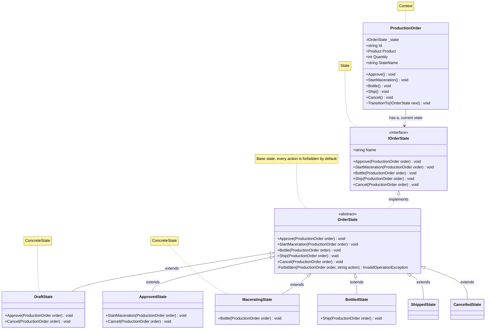
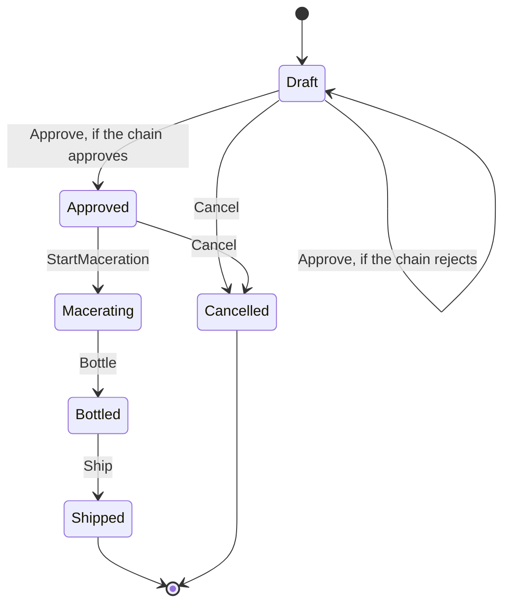
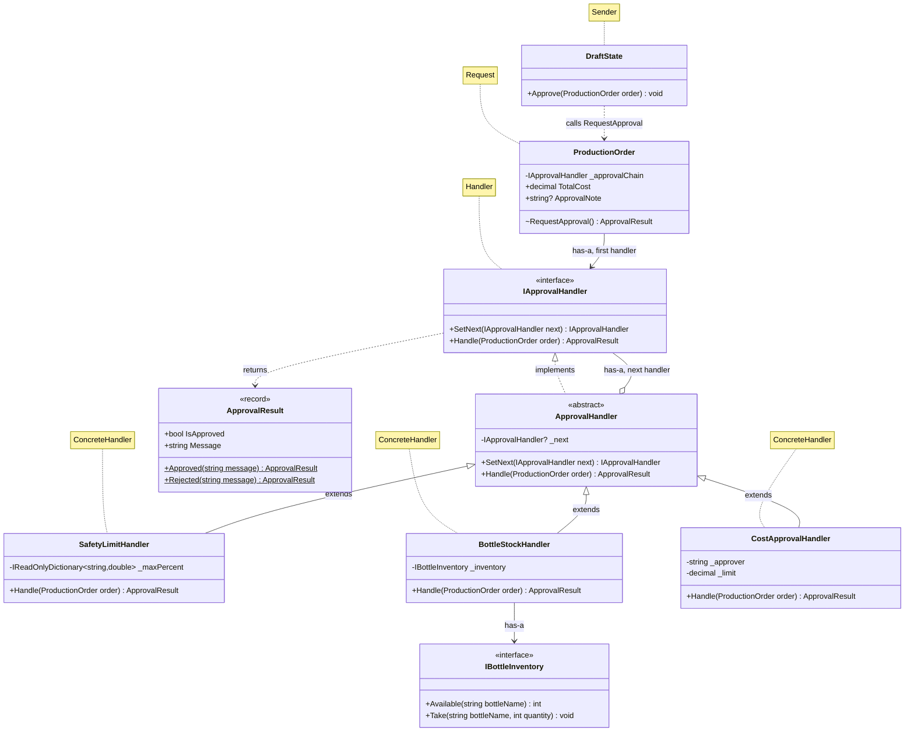
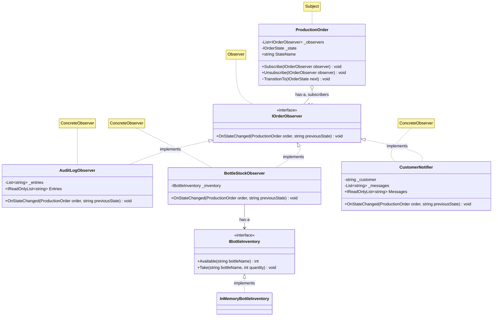
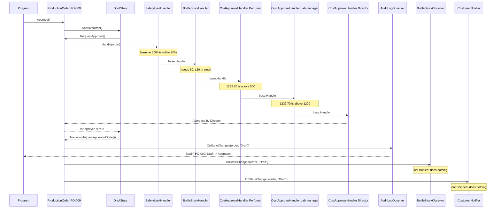

# Laboratory Work Nr. 4. Behavioral Design Patterns

Course: TMPS, Software Design Techniques and Mechanisms\
Topic: Implementation of behavioral design patterns\
Project: `FragranceComposer`\
Technology: C# / .NET 10 console application, xUnit for unit tests\
Author: Oberșt Eduard, FAF-243\
Repository branch: `lab4`

---

## 1. Objectives

1. Study the behavioral design patterns and how they divide the work and the communication between objects.
2. Extend the FragranceComposer domain from Labs 1 to 3 with three behavioral patterns, each one solving a real problem of the domain.
3. Connect the patterns on one execution path, with client code that depends only on interfaces.
4. Let the user change the behavior of the program while it is running.
5. Prove the key property of every pattern with unit tests that run with `dotnet test`.

---

## 2. Domain Description

FragranceComposer is a console application that models the work of a small perfume house. A perfumer composes a fragrance from ingredients, and every ingredient belongs to the top, heart or base notes and has a price per ml. The finished fragrance, or a layering of several fragrances, is released as a product in the Luxury, Classic or Travel line. Lab 2 added the Builder, Abstract Factory and Prototype patterns for creating fragrances and products, and Lab 3 added Composite, Proxy and Decorator for layered scents, secret formulas and gift add-ons.

This laboratory work adds production. When a shop needs a product, the perfume house opens a production order for a number of bottles. The order is approved, then the perfume macerates, which means the mixed oils and alcohol rest for some time so the scent becomes stable. After that the batch is bottled and shipped. Production brings three new situations into the domain, and each of them is solved by one behavioral pattern.

| # | Situation in the domain | Pattern | Main classes |
|---|---|---|---|
| 1 | An order allows different actions at each step of production. A Draft order can be approved but not shipped, and a Macerating order can be bottled but no longer cancelled | State | `ProductionOrder`, `IOrderState`, `OrderState` and six states |
| 2 | Before production starts, an order is checked for ingredient safety limits and bottle stock, and then it must be signed by someone whose cost limit covers the order | Chain of Responsibility | `IApprovalHandler`, `ApprovalHandler` and three handlers |
| 3 | Other parts of the perfume house react when an order changes state. The audit log records every step, the warehouse takes the bottles when the batch is bottled and the customer gets a message when it is shipped | Observer | `IOrderObserver` and three observers |

The program shows the patterns in three new sections of `Program.cs`. Section 8 moves an order of Beach Evening through its whole life and tries forbidden actions on the way. Section 9 sends six orders through the approval chain, and each one is decided by a different handler. Section 10 subscribes three observers to an order, unsubscribes one of them in the middle of production and shows that the bottled batch changes the decision for the next order. The interactive mode, started with `--interactive`, lets the user do the same things from the keyboard.

---

## 3. Project Structure

```
FragranceComposer/
├── Builders/, Factories/, Prototypes/                                    (unchanged, Lab 2)
├── Composites/, Proxies/, Decorators/                                    (unchanged, Lab 3)
├── Components/, Concentrations/                                          (unchanged)
├── States/                                                               (new)
│   ├── IOrderState.cs            the actions an order can receive
│   ├── OrderState.cs             abstract base, every action is forbidden by default
│   ├── DraftState.cs             approve through the chain, cancel
│   ├── ApprovedState.cs          start maceration, cancel
│   ├── MaceratingState.cs        bottle
│   ├── BottledState.cs           ship
│   ├── ShippedState.cs           final state
│   └── CancelledState.cs         final state
├── Approvals/                                                            (new)
│   ├── IApprovalHandler.cs       SetNext and Handle
│   ├── ApprovalHandler.cs        abstract base, passes the order to the next handler
│   ├── ApprovalResult.cs         approved or rejected, with a message
│   ├── SafetyLimitHandler.cs     rejects an ingredient above its limit
│   ├── BottleStockHandler.cs     rejects an order larger than the bottle stock
│   └── CostApprovalHandler.cs    approves an order within the limit of one approver
├── Observers/                                                            (new)
│   ├── IOrderObserver.cs         OnStateChanged
│   ├── AuditLogObserver.cs       records every transition
│   ├── BottleStockObserver.cs    takes the bottles from stock when Bottled
│   └── CustomerNotifier.cs       sends a message when Shipped
├── Client/                                                               (new)
│   └── InteractiveMode.cs        commands typed by the user
├── Interfaces/
│   ├── IBottleInventory.cs       Available and Take                     (new)
│   └── ...                                                               (unchanged)
├── Models/
│   ├── ProductionOrder.cs        context of State, subject of Observer   (new)
│   └── ...                                                               (unchanged)
├── Repositories/
│   ├── InMemoryBottleInventory.cs  stock of every kind of bottle         (new)
│   └── InMemoryIngredientRepository.cs                                   (unchanged)
└── Program.cs                    sections 8, 9, 10 and --interactive     (changed)
FragranceComposer.Tests/
├── StateTests.cs                 3 tests                                 (new)
├── ChainTests.cs                 4 tests                                 (new)
├── ObserverTests.cs              4 tests                                 (new)
└── CompositeTests.cs, ProxyTests.cs, DecoratorTests.cs                   (unchanged)
```

No class from the earlier labs was changed. A production order holds a `Product` from Lab 3, so everything new is added next to the old code.

---

## 4. Implemented Behavioral Patterns

Each pattern below has the problem it solves, a table of GoF roles, a class diagram, the code where the pattern is best seen and its unit tests. In the class diagrams, a dashed line with a hollow triangle means implements, a solid line with a hollow triangle means extends, and a line with a diamond or an arrow means has-a. The notes next to the classes show the GoF role of each class.

### 4.1 State

#### Problem

A production order has six states, Draft, Approved, Macerating, Bottled, Shipped and Cancelled. The same action has a different result in each of them. Approving a Draft order sends it to the approval chain, but approving a Shipped order is an error. An order can be cancelled while it is a Draft or Approved, but not after the maceration started, because the oils are already mixed. With one `switch` on a state enum inside `ProductionOrder`, all five actions would need their own `switch`, and a new state would mean editing every one of them. The State pattern moves the rules of each state into its own class, and the order only passes every action to its current state.

| GoF role | Class | Responsibility here |
|---|---|---|
| Context | `ProductionOrder` | Holds the current state and passes every action to it |
| State | `IOrderState` | The five actions an order can receive, and the name of the state |
| Base state | `OrderState` | Abstract class where every action throws by default, so a state only overrides what it allows |
| ConcreteState | `DraftState`, `ApprovedState`, `MaceratingState`, `BottledState`, `ShippedState`, `CancelledState` | Each allows its own actions and chooses the next state |
| Client | `Program`, `InteractiveMode` | Call the actions on the order and never check the state themselves |

#### Class diagram



The transitions between the states are shown below. Every action that has no arrow from a state throws `InvalidOperationException` in that state.



#### Code

[FragranceComposer/Models/ProductionOrder.cs, lines 38-42](FragranceComposer/Models/ProductionOrder.cs#L38-L42)

```csharp
    public void Approve() => _state.Approve(this);
    public void StartMaceration() => _state.StartMaceration(this);
    public void Bottle() => _state.Bottle(this);
    public void Ship() => _state.Ship(this);
    public void Cancel() => _state.Cancel(this);
```

[FragranceComposer/States/OrderState.cs, lines 4-16](FragranceComposer/States/OrderState.cs#L4-L16)

```csharp
public abstract class OrderState : IOrderState
{
    public abstract string Name {get;}

    public virtual void Approve(ProductionOrder order) => throw Forbidden(order, "approve");
    public virtual void StartMaceration(ProductionOrder order) => throw Forbidden(order, "start maceration of");
    public virtual void Bottle(ProductionOrder order) => throw Forbidden(order, "bottle");
    public virtual void Ship(ProductionOrder order) => throw Forbidden(order, "ship");
    public virtual void Cancel(ProductionOrder order) => throw Forbidden(order, "cancel");

    private InvalidOperationException Forbidden(ProductionOrder order, string action) =>
     new($"Cannot {action} order {order.Id} while it is {Name}");
}
```

[FragranceComposer/States/DraftState.cs, lines 4-14](FragranceComposer/States/DraftState.cs#L4-L14)

```csharp
public class DraftState : OrderState
{
    public override string Name => "Draft";
    public override void Approve(ProductionOrder order)
    {
        if ( order.RequestApproval().IsApproved)
        order.TransitionTo(new ApprovedState());
    }

    public override void Cancel(ProductionOrder order) => order.TransitionTo(new CancelledState());
}
```

`ProductionOrder` has no `if` or `switch` on its state. Every action goes to the current `IOrderState` object, and that object decides if the action is allowed and which state comes next. Because `OrderState` forbids everything by default, a concrete state lists only the actions it allows, so `MaceratingState` is one line and a new state, for example a quality check between Macerating and Bottled, is a new class.

#### Unit tests

| Test | What it checks |
|---|---|
| `ValidTransitions_FollowTheLifecycleUntilShipped` | An order goes from Draft to Approved, Macerating, Bottled and Shipped, and `StateName` is checked after every step. |
| `ForbiddenTransition_IsRejected_AndStateDoesNotChange` | Shipping a Draft order throws `InvalidOperationException` and the order stays Draft. Cancelling a Macerating order also throws, and the order stays Macerating. |
| `CancelledOrder_RejectsEveryAction` | After `Cancel`, all five actions throw and the order stays Cancelled, so a final state really has no way out. |

The order in these tests gets a chain with one `CostApprovalHandler` whose limit is `decimal.MaxValue`, so every approval passes and the tests only check the states. The build and discovery lines are left out of the test logs here and in the next sections.

```
$ dotnet test --filter "FullyQualifiedName~StateTests" --logger "console;verbosity=normal"
  Passed FragranceComposer.Tests.StateTests.ValidTransitions_FollowTheLifecycleUntilShipped [21 ms]
  Passed FragranceComposer.Tests.StateTests.ForbiddenTransition_IsRejected_AndStateDoesNotChange [1 ms]
  Passed FragranceComposer.Tests.StateTests.CancelledOrder_RejectsEveryAction [1 ms]
Test Run Successful.
Total tests: 3
     Passed: 3
 Total time: 1.0488 Seconds
```

### 4.2 Chain of Responsibility

#### Problem

Before a batch is produced, several people and rules have to agree. The safety check makes sure that no ingredient is above its limit, for example Jasmine at most 20% and Rose at most 30% in the demo. The stock check makes sure there are enough bottles. After that, the order needs a signature, and who can sign depends on the cost. A perfumer can approve up to 500 EUR, a lab manager up to 1200 EUR and the director up to 2000 EUR. If all these checks were written inside `DraftState`, the state would know every rule, and a new rule would mean editing it. With Chain of Responsibility every rule is a separate handler, the client puts them in order, and the order is passed along until one handler decides.

| GoF role | Class | Responsibility here |
|---|---|---|
| Handler | `IApprovalHandler` | `SetNext` links the next handler, `Handle` returns an `ApprovalResult` |
| Base handler | `ApprovalHandler` | Keeps the link to the next handler. Passes the order on, and at the end of the chain returns a rejection |
| ConcreteHandler | `SafetyLimitHandler` | Rejects the order if an ingredient is above its limit, otherwise passes it on |
| ConcreteHandler | `BottleStockHandler` | Rejects the order if there are not enough bottles, otherwise passes it on |
| ConcreteHandler | `CostApprovalHandler` | Approves the order if the cost is within its limit, otherwise passes it on. Used three times with different data |
| Request | `ProductionOrder` | The order that travels along the chain |
| Sender | `DraftState` | Starts the request through `ProductionOrder.RequestApproval` and does not know which handler decides |
| Client | `Program`, `InteractiveMode` | Create the handlers and link them in order |

#### Class diagram



#### Code

[FragranceComposer/Approvals/ApprovalHandler.cs, lines 4-17](FragranceComposer/Approvals/ApprovalHandler.cs#L4-L17)

```csharp
public abstract class ApprovalHandler : IApprovalHandler
{
    private IApprovalHandler? _next;
    public IApprovalHandler SetNext(IApprovalHandler next)
    {
        _next = next;
        return next;
    }

    public virtual ApprovalResult Handle(ProductionOrder order) =>
     _next is not null
     ? _next.Handle(order)
     : ApprovalResult.Rejected($"no handler in the chain approved {order.TotalCost:F2} EUR");
}
```

[FragranceComposer/Approvals/CostApprovalHandler.cs, lines 15-20](FragranceComposer/Approvals/CostApprovalHandler.cs#L15-L20)

```csharp
    public override ApprovalResult Handle(ProductionOrder order)
    {
        if (order.TotalCost <= _limit)
        return ApprovalResult.Approved($"approved by {_approver}: {order.TotalCost:F2} EUR is within the {_limit:F2} EUR limit");
        return base.Handle(order);
    }
```

Every concrete handler either returns its own decision or calls `base.Handle`, which passes the order to `_next`. When there is no next handler, `ApprovalHandler` returns a rejection with a clear message, so a request never falls off the end of the chain without a result. `SetNext` returns the handler it received, which is why the client can write the whole chain as `.SetNext(...).SetNext(...)`, and no handler knows which one comes after it.

The client builds the chain in [FragranceComposer/Program.cs, lines 166-176](FragranceComposer/Program.cs#L166-L176).

```csharp
IBottleInventory bottleInventory = new InMemoryBottleInventory();
IApprovalHandler approvalChain = new SafetyLimitHandler(new Dictionary<string, double>
{
    ["Jasmine"] = 20,
    ["Rose"] = 30
});
approvalChain
.SetNext(new BottleStockHandler(bottleInventory))
.SetNext(new CostApprovalHandler("Perfumer", 500m))
.SetNext(new CostApprovalHandler("Lab manager", 1200m))
.SetNext(new CostApprovalHandler("Director", 2000m));
```

A rejection is a normal result here and not an exception. The order stays Draft and `ApprovalNote` keeps the reason, so the user can change the order and try again. Exceptions are used only for actions that are forbidden by the State pattern.

#### Unit tests

| Test | What it checks |
|---|---|
| `Request_IsApprovedByTheFirstApproverWhoseLimitCoversTheCost` | The limits are set around the real cost of the order. The perfumer's limit is 1 EUR below it, the lab manager's is 1 EUR above it, so the order is approved by the lab manager and the director is never asked. |
| `UnhandledRequest_EndsTheChainSafely_AndTheOrderStaysDraft` | A chain with only one approver whose limit is too low ends with the rejection "no handler in the chain approved", and the order stays Draft without any exception. |
| `SafetyCheck_RejectsBeforeAnyApproverIsAsked` | With a Jasmine limit of 20%, the gourmand fragrance with 25% Jasmine is rejected by the safety check even though the director after it would approve any cost. The aquatic fragrance has no Jasmine and is approved. |
| `StockCheck_RefectsAnOrderLargerThanTheBottleStock` | An order of 121 bottles in the Classic line is rejected with the exact message "needs 121 x Glass bottle, only 120 in stock". |

```
$ dotnet test --filter "FullyQualifiedName~ChainTests" --logger "console;verbosity=normal"
  Passed FragranceComposer.Tests.ChainTests.SafetyCheck_RejectsBeforeAnyApproverIsAsked [22 ms]
  Passed FragranceComposer.Tests.ChainTests.StockCheck_RefectsAnOrderLargerThanTheBottleStock [1 ms]
  Passed FragranceComposer.Tests.ChainTests.UnhandledRequest_EndsTheChainSafely_AndTheOrderStaysDraft [< 1 ms]
  Passed FragranceComposer.Tests.ChainTests.Request_IsApprovedByTheFirstApproverWhoseLimitCoversTheCost [< 1 ms]
Test Run Successful.
Total tests: 4
     Passed: 4
 Total time: 1.0295 Seconds
```

All four tests call `order.Approve()` and not the handlers directly, so they also check that `DraftState` really sends the order through the chain.

### 4.3 Observer

#### Problem

When an order changes its state, other parts of the perfume house have to react. The audit log records every step. The warehouse takes the bottles out of stock when the batch is bottled. The shop that ordered the perfume gets a message when it is shipped. If the state classes called these departments directly, `BottledState` would need to know the warehouse and `ShippedState` would need to know the customer, and every new department would mean editing the states. With Observer the order only announces that its state changed, and every observer decides what to do with it. The observers can also be added or removed while the order is in production.

| GoF role | Class | Responsibility here |
|---|---|---|
| Subject | `ProductionOrder` | Keeps a list of `IOrderObserver`, has `Subscribe` and `Unsubscribe`, and notifies the list in `TransitionTo` |
| Observer | `IOrderObserver` | `OnStateChanged(order, previousState)` |
| ConcreteObserver | `AuditLogObserver` | Records every transition, for example "PO-009: Draft -> Approved" |
| ConcreteObserver | `BottleStockObserver` | When the new state is Bottled, takes the bottles of the order from `IBottleInventory` |
| ConcreteObserver | `CustomerNotifier` | When the new state is Shipped, sends a message to the customer |
| Client | `Program`, `InteractiveMode` | Subscribe and unsubscribe observers while the program runs |

#### Class diagram



#### Code

[FragranceComposer/Models/ProductionOrder.cs, lines 30-36 and 51-57](FragranceComposer/Models/ProductionOrder.cs#L30-L57)

```csharp
    public void Subscribe(IOrderObserver observer)
    {
        if (!_observers.Contains(observer))
        _observers.Add(observer);
    }

    public void Unsubscribe(IOrderObserver observer) => _observers.Remove(observer);
    // ...
    internal void TransitionTo(IOrderState next)
    {
        string previous = _state.Name;
        _state = next;
        foreach (var observer in _observers.ToList())
        observer.OnStateChanged(this, previous);
    }
```

[FragranceComposer/Observers/BottleStockObserver.cs, lines 14-21](FragranceComposer/Observers/BottleStockObserver.cs#L14-L21)

```csharp
    public void OnStateChanged(ProductionOrder order, string previousState)
    {
        if(order.StateName != "Bottled")
        return;
        string bottle = order.Product.Bottle.Name;
        _inventory.Take(bottle, order.Quantity);
        Console.WriteLine($"  [stock] took {order.Quantity} x {bottle}, {_inventory.Available(bottle)} left");
    }
```

Every state change goes through `TransitionTo`, so the notification is in one place and no state class can forget it. The order knows its observers only as `IOrderObserver`, and the loop goes over a copy of the list made with `ToList`, so an observer can unsubscribe during a notification without breaking the loop. Every observer receives the order itself and reads what it needs, which is why `BottleStockObserver` reacts only to Bottled and ignores the other changes.

#### Unit tests

| Test | What it checks |
|---|---|
| `SubscribedObserversAreNotified_AndUnsubscribedOnesAreNot` | Two audit logs are subscribed. After `Approve` both have one entry. The second one is unsubscribed, and after `StartMaceration` only the first one gets the new entry. |
| `RejectedApproval_ChangesNoState_AndNotifiesNobody` | The only approver has a limit of 0 EUR, so the approval is rejected. The order stays Draft and the audit log stays empty, because nothing is announced when the state does not change. |
| `CustomerIsNotrifiedOnlyWhenTheOrderIsShipped` | The customer gets no message after Approved, Macerating and Bottled, and gets exactly one message after Shipped. |
| `BottleOrder_TakesBottlesFromStock_SoTheStockCheckRejectsTheNextOrder` | An order of 100 bottles is bottled and the stock of glass bottles goes from 120 to 20. A second order of 30 bottles is then rejected by the stock check with "only 20 in stock". |

```
$ dotnet test --filter "FullyQualifiedName~ObserverTests" --logger "console;verbosity=normal"
  Passed FragranceComposer.Tests.ObserverTests.CustomerIsNotrifiedOnlyWhenTheOrderIsShipped [26 ms]
  Passed FragranceComposer.Tests.ObserverTests.RejectedApproval_ChangesNoState_AndNotifiesNobody [1 ms]
  Passed FragranceComposer.Tests.ObserverTests.SubscribedObserversAreNotified_AndUnsubscribedOnesAreNot [11 ms]
  Passed FragranceComposer.Tests.ObserverTests.BottleOrder_TakesBottlesFromStock_SoTheStockCheckRejectsTheNextOrder [4 ms]
Test Run Successful.
Total tests: 4
     Passed: 4
 Total time: 1.0451 Seconds
```

The last test goes through all three patterns. The State pattern moves the order to Bottled, the observer changes the stock, and the Chain of Responsibility uses the new stock for the next order.

---

## 5. How the Patterns Work Together

The three patterns are connected on one execution path. When the client calls `Approve` on a Draft order, the call goes to the current state, `DraftState` sends the order through the approval chain, and if the chain approves it, the order moves to `ApprovedState` and announces the change to its observers. The diagram below shows this call for order PO-009 from section 10 of `Program.cs`, with the real values. The order is 60 bottles of Beach Evening in the Classic line, which costs 60 × 20.545 = 1232.70 EUR.



The client works only with interfaces and with the public actions of the order.

[FragranceComposer/Program.cs, lines 234-240](FragranceComposer/Program.cs#L234-L240)

```csharp
var bigOrder = new ProductionOrder("PO-009", batch, 60, approvalChain);
bigOrder.Subscribe(audit);
bigOrder.Subscribe(stockKeeper);
bigOrder.Subscribe(boutique);
Console.WriteLine($"{bigOrder.Id}: {bigOrder.Quantity} x {batch.Scent.Name}, glass bottles in stock: {bottleInventory.Available("Glass bottle")}");

Try(bigOrder, "approve", bigOrder.Approve);
```

The patterns also work in the other direction. When PO-009 is bottled, `BottleStockObserver` takes 60 glass bottles from the same `bottleInventory` object that `BottleStockHandler` reads. Because of this, PO-010 with 80 bottles is rejected by the chain with "only 60 in stock", although the same order would have passed before PO-009 was bottled.

The patterns from the earlier labs create the objects that the new patterns use. The table below shows how.

| Element from Lab 2 or 3 | Used in Lab 4 for |
|---|---|
| `FragranceDirector`, `FragranceBuilder` | build Black Sea Breeze and Vanilla Night, which are inside the ordered products |
| `IProductLineFactory` and the line factories | supply the bottle and packaging of every ordered product. In the interactive mode the user chooses the factory by typing the line |
| `FragranceRegistry`, `Fragrance.CloneAs` | Vanilla Night Extrait in PO-006 is a clone of Vanilla Night in Parfum concentration |
| `LayeredScent` | Beach Evening and Weekend Ritual are layered scents. `SafetyLimitHandler` reads their combined composition through `IScent` without knowing they are layered |
| `Product` | a production order holds a `Product`, and `TotalCost` is the quantity times `Product.Cost` |

---

## 6. Behavior Changed at Runtime

The program has an interactive mode, started with the command below. Without the argument the program runs the scripted demo as before.

```bash
dotnet run --project FragranceComposer -- --interactive
```

In this mode the user types commands, and three things change while the program is running. The state of an order changes through the commands `approve`, `macerate`, `bottle`, `ship` and `cancel`. The observers of an order change through `subscribe` and `unsubscribe`. The approval chain changes through `toggle safety` and `toggle stock`, which turn a handler on or off for the orders created after the command. The session below shows all three.

```
> new classic gourmand 30
PO-1: 30 x Vanilla Night [Classic line]: Glass bottle (50 ml), Cardboard box, 802.65 EUR [Draft]
   subscribed: audit, stock

> approve po-1
PO-1 approve -> Draft
   safety check: Jasmine is 25.0%, the limit is 20.0%

> toggle safety
safety check OFF, stock check ON (used by orders created from now on)

> new classic gourmand 30
PO-2: 30 x Vanilla Night [Classic line]: Glass bottle (50 ml), Cardboard box, 802.65 EUR [Draft]
   subscribed: audit, stock

> approve po-2
   [audit] PO-2: Draft -> Approved
PO-2 approve -> Approved
   approved by Lab manager: 802.65 EUR is within the 1200.00 EUR limit

> macerate po-2
   [audit] PO-2: Approved -> Macerating
PO-2 macerate -> Macerating

> unsubscribe po-2 audit
audit unsubscribed from PO-2

> subscribe po-2 customer
customer subscribed to PO-2

> bottle po-2
  [stock] took 30 x Glass bottle, 90 left
PO-2 bottle -> Bottled

> ship po-2
  [customer] to Riviera boutique: your 30 x Vanilla Night have been shipped
PO-2 ship -> Shipped

> ship po-2
REJECTED: Cannot ship order PO-2 while it is Shipped

> list
PO-1 [Draft] 30 x Vanilla Night (Classic), 802.65 EUR
PO-2 [Shipped] 30 x Vanilla Night (Classic), 802.65 EUR
Crystal bottle: 30 in stock
Glass bottle: 90 in stock
Travel spray bottle: 500 in stock
safety check OFF, stock check ON
```

The same gourmand order is rejected by the safety check while it is on and approved after the user turns it off. After `unsubscribe po-2 audit` the audit log prints nothing for Bottled and Shipped, and the customer, subscribed in the middle of production, gets the message when the order is shipped. The second `ship` is rejected by `ShippedState`.

The interactive mode builds a new chain for every new order from the switches the user set.

[FragranceComposer/Client/InteractiveMode.cs, lines 131-144](FragranceComposer/Client/InteractiveMode.cs#L131-L144)

```csharp
    private IApprovalHandler BuildApprovalChain()
    {
        var handlers = new List<IApprovalHandler>();
        if (_safetyCheck)
            handlers.Add(new SafetyLimitHandler(new Dictionary<string, double> { ["Jasmine"] = 20, ["Rose"] = 30 }));
        if (_stockCheck)
            handlers.Add(new BottleStockHandler(_inventory));
        handlers.Add(new CostApprovalHandler("Perfumer", 500m));
        handlers.Add(new CostApprovalHandler("Lab manager", 1200m));
        handlers.Add(new CostApprovalHandler("Director", 2000m));

        for (int i = 0; i < handlers.Count - 1; i++)
            handlers[i].SetNext(handlers[i + 1]);
        return handlers[0];
```

A turned off check is simply not added to the list, and the loop links the handlers in the order of the list. The interactive mode only reads the commands and calls the patterns. The rules stay in the state classes, the handlers and the observers.

---

## 7. Results

### 7.1 Program output

```bash
dotnet run --project FragranceComposer
```

The first part of the output comes from the Lab 2 and Lab 3 scenarios and is the same as in their reports, so only the new sections 8, 9 and 10 are shown here.

```
--- State ---
PO-001: 50 x Beach Evening [Classic line]: Glass bottle (50 ml), Cardboard box [Draft]
PO-001 ship REJECTED: Cannot ship order PO-001 while it is Draft
PO-001 approve -> Approved
PO-001 start maceration -> Macerating
PO-001 cancel REJECTED: Cannot cancel order PO-001 while it is Macerating
PO-001 bottle -> Bottled
PO-001 ship -> Shipped
PO-001 approve REJECTED: Cannot approve order PO-001 while it is Shipped
PO-002 cancel -> Cancelled
PO-002 approve REJECTED: Cannot approve order PO-002 while it is Cancelled

--- Chain of Responsibility ---
PO-003: 20 x Beach Evening in Glass bottle, 410.90 EUR
PO-003 approve -> Approved
   approved by Perfumer: 410.90 EUR is within the 500.00 EUR limit
PO-004: 50 x Beach Evening in Glass bottle, 1027.25 EUR
PO-004 approve -> Approved
   approved by Lab manager: 1027.25 EUR is within the 1200.00 EUR limit
PO-005: 110 x Beach Evening in Glass bottle, 2259.95 EUR
PO-005 approve -> Draft
   no handler in the chain approved 2259.95 EUR
PO-006: 10 x Vanilla Night Extrait in Crystal bottle, 868.75 EUR
PO-006 approve -> Draft
   safety check: Jasmine is 25.0%, the limit is 20.0%
PO-007: 40 x Weekend Ritual in Crystal bottle, 2450.70 EUR
PO-007 approve -> Draft
   stock check: needs 40 x Crystal bottle, only 30 in stock
PO-008: 25 x Weekend Ritual in Crystal bottle, 1531.69 EUR
PO-008 approve -> Approved
   approved by Director: 1531.69 EUR is within the 2000.00 EUR limit

--- Observer ---
PO-009: 60 x Beach Evening, glass bottles in stock: 120
   [audit] PO-009: Draft -> Approved
PO-009 approve -> Approved
   [audit] PO-009: Approved -> Macerating
PO-009 start maceration -> Macerating
  (audit log unsubscribed)
  [stock] took 60 x Glass bottle, 60 left
PO-009 bottle -> Bottled
  [customer] to Riviera boutique: your 60 x Beach Evening have been shipped
PO-009 ship -> Shipped
PO-010 approve -> Draft
  stock check: needs 80 x Glass bottle, only 60 in stock
```

| Output | Pattern | What it shows |
|---|---|---|
| PO-001 is rejected when shipped as a Draft, cancelled while Macerating and approved after Shipped | State | Each state allows only its own actions, and a rejected action does not change the state |
| PO-001 goes from Draft to Shipped | State | The valid transitions follow the production order of the perfume house |
| PO-003, PO-004 and PO-008 approved by three different people | Chain of Responsibility | The first approver whose limit covers the cost decides, and the next ones are not asked |
| PO-006 rejected by the safety check, PO-007 by the stock check | Chain of Responsibility | A check at the start of the chain can stop the request before any approver sees it |
| PO-005 with no handler that approved | Chain of Responsibility | The end of the chain gives a defined result |
| The `[audit]` lines stop after the audit log is unsubscribed | Observer | An observer can leave while the order is in production |
| `[stock]` only on Bottled, `[customer]` only on Shipped | Observer | Every observer reacts only to the change it needs |
| PO-010 rejected with only 60 in stock | Observer and Chain of Responsibility | The observer changed the stock and the chain used the new value |

The `[audit]` line is printed before the line `PO-009 approve -> Approved`. The observers run inside `Approve`, and the helper `Try` in `Program.cs` prints the new state only after `Approve` returns.

### 7.2 Checking the cost by hand

Beach Evening costs 0.3069 EUR per ml, as printed in the Lab 3 report. One bottle in the Classic line is 50 ml × 0.3069 + 4.00 for the glass bottle + 1.20 for the cardboard box = 20.545 EUR. Vanilla Night Extrait costs 2.395 EUR per ml of oil, and with 25% oil in the Parfum concentration one bottle in the Luxury line is 100 ml × 0.59875 + 18.00 + 9.00 = 86.875 EUR.

| Order | Calculation | Total | Decision |
|---|---|---|---|
| PO-003 | 20 × 20.545 | 410.90 EUR | within 500, Perfumer |
| PO-004 | 50 × 20.545 | 1027.25 EUR | above 500, within 1200, Lab manager |
| PO-009 | 60 × 20.545 | 1232.70 EUR | above 1200, within 2000, Director |
| PO-005 | 110 × 20.545 | 2259.95 EUR | above 2000, no handler |
| PO-006 | 10 × 86.875 | 868.75 EUR | rejected earlier by the safety check, Jasmine 25% |

### 7.3 All unit tests

```
$ dotnet test --logger "console;verbosity=normal"
Starting test execution, please wait...
A total of 1 test files matched the specified pattern.
[xUnit.net 00:00:00.00] xUnit.net VSTest Adapter v3.1.4+50e68bbb8b (64-bit .NET 10.0.15)
[xUnit.net 00:00:00.11]   Discovering: FragranceComposer.Tests
[xUnit.net 00:00:00.16]   Discovered:  FragranceComposer.Tests
[xUnit.net 00:00:00.19]   Starting:    FragranceComposer.Tests
  Passed FragranceComposer.Tests.StateTests.ValidTransitions_FollowTheLifecycleUntilShipped [19 ms]
  Passed FragranceComposer.Tests.DecoratorTests.Decorator_AddsItsOwnPriceAndTextToTheWrappedProduct [22 ms]
  Passed FragranceComposer.Tests.CompositeTests.Composite_WeightsCompositionAndCostBySprays [20 ms]
  Passed FragranceComposer.Tests.ChainTests.SafetyCheck_RejectsBeforeAnyApproverIsAsked [19 ms]
  Passed FragranceComposer.Tests.ProxyTests.Customer_CanReadNameAndCost_ButNotComposition [23 ms]
  Passed FragranceComposer.Tests.ProxyTests.CompositeContainingProxy_HidesCompositionButStillGivesCost [< 1 ms]
  Passed FragranceComposer.Tests.CompositeTests.EmptyComposite_Throws [1 ms]
  Passed FragranceComposer.Tests.ProxyTests.Perfumer_GetsTheRealCompositionUnchanged [< 1 ms]
  Passed FragranceComposer.Tests.ChainTests.StockCheck_RefectsAnOrderLargerThanTheBottleStock [1 ms]
  Passed FragranceComposer.Tests.DecoratorTests.Decorators_StackedInAnyOrder_GiveTheSameCost [1 ms]
  Passed FragranceComposer.Tests.StateTests.ForbiddenTransition_IsRejected_AndStateDoesNotChange [1 ms]
  Passed FragranceComposer.Tests.ObserverTests.CustomerIsNotrifiedOnlyWhenTheOrderIsShipped [25 ms]
[xUnit.net 00:00:00.32]   Finished:    FragranceComposer.Tests
  Passed FragranceComposer.Tests.CompositeTests.LeafAndComposite_AreUsedThroughTheSameInterface [< 1 ms]
  Passed FragranceComposer.Tests.ChainTests.UnhandledRequest_EndsTheChainSafely_AndTheOrderStaysDraft [< 1 ms]
  Passed FragranceComposer.Tests.DecoratorTests.DecoratedProduct_OverCompositeAndProxy_IsPricedForACosutumer [< 1 ms]
  Passed FragranceComposer.Tests.ChainTests.Request_IsApprovedByTheFirstApproverWhoseLimitCoversTheCost [< 1 ms]
  Passed FragranceComposer.Tests.CompositeTests.Composite_CanContainAnotherComposite [< 1 ms]
  Passed FragranceComposer.Tests.ObserverTests.RejectedApproval_ChangesNoState_AndNotifiesNobody [< 1 ms]
  Passed FragranceComposer.Tests.StateTests.CancelledOrder_RejectsEveryAction [1 ms]
  Passed FragranceComposer.Tests.ObserverTests.SubscribedObserversAreNotified_AndUnsubscribedOnesAreNot [10 ms]
  Passed FragranceComposer.Tests.ObserverTests.BottleOrder_TakesBottlesFromStock_SoTheStockCheckRejectsTheNextOrder [4 ms]

Test Run Successful.
Total tests: 21
     Passed: 21
 Total time: 1.0092 Seconds
```

All 21 tests pass, the 10 tests from Lab 3 and the 11 new ones. The observers also print to the console while the tests run, and these lines were removed from the log above. None of the tests need console input.

---

## 8. Conclusions

In this laboratory work I added three behavioral patterns to FragranceComposer. State controls which actions a production order allows at each step, from Draft to Shipped or Cancelled. Chain of Responsibility checks the order for safety and stock and finds the person who can approve its cost. Observer lets the audit log, the warehouse and the customer react to every change of the order. All three work on the same call when an order is approved, and the products in the orders are still built with the Builder, the factories and the layered scents from the earlier labs.

The part that was harder than I expected was connecting the chain to the states. In the first version `DraftState` moved the order to Approved without any check. When the chain was added, the order needed it in the constructor, so the State tests had to change too, and I gave them a chain that approves everything. I also had to decide what a rejection is. I chose to keep a rejected order in Draft with the reason in `ApprovalNote`, because a rejected order is a normal situation in a perfume house. A forbidden action like shipping a Draft order is a mistake of the caller, so it still throws an exception.

I also struggled with the bottle stock. In the Chain of Responsibility commit the stock check created its own `InMemoryBottleInventory`. When I added `BottleStockObserver`, it would have taken the bottles from a different object, and the chain would never see that the stock went down. I created one `bottleInventory` in `Program.cs` and passed the same object to both classes. The test `BottleOrder_TakesBottlesFromStock_SoTheStockCheckRejectsTheNextOrder` checks exactly this case. The order of the console lines was confusing at first too, because the `[audit]` line appears before the result of the action that caused it.

If I designed this again, I would change three things. First, the stock is only checked at approval and is not reserved, so two approved orders can count on the same bottles, and `Take` has no check, so the stock can go below zero. Reserving the bottles when an order is approved would solve both problems. Second, the observers compare the state name with a string like "Bottled". A typo in this string would not give any error, and the observer would just never react. Third, in the interactive mode a toggle only affects new orders, because every order gets its chain in the constructor. Giving the order an object that builds the chain at the moment of approval would make the toggle work for orders that already exist.

Overall, each pattern comes from a real step of production in a perfume house. The order has clear steps, so it fits State. The approval has several rules and several people with different limits, so it fits Chain of Responsibility. Several departments react to the same order, so it fits Observer. The client code works only with `IOrderState`, `IApprovalHandler` and `IOrderObserver`, and a new state, a new approval rule or a new observer is added as a new class.
